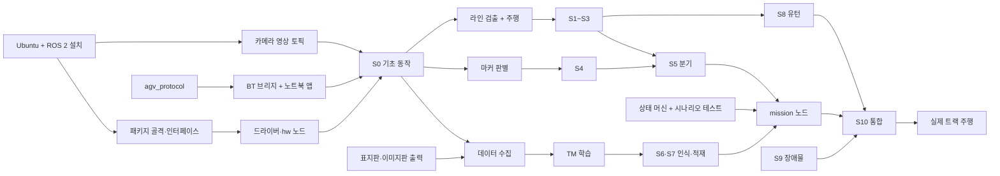

# 개발 순서 및 절차

> 3단계(준비)부터 6단계(시나리오 테스트)까지 **무엇을 어떤 순서로, 어떤 절차로** 개발하는지 정한다.
> 기간 4주, 팀 3~4명 기준. 주차는 W1~W4로 표기하고 실제 날짜는 시작일이 정해지면 채운다.
> 실행 점검표: [주차별 실행 체크리스트](weekly_checklist.md)
> 관련: [소프트웨어 구조 설계](software/software_architecture.md) 7·8·10절, [단계별 테스트 트랙](track/test_track.md), [진행 프로세스](../PROCESS.md)

## 1. 원칙
1. **위험한 것부터** — Ubuntu에서 Camera Module 3 동작, TFLite 런타임, 블루투스 영상 속도처럼 막히면 설계를 바꿔야 하는 항목을 W1에 먼저 확인한다.
2. **하드웨어 없이 할 수 있는 일은 하드웨어를 기다리지 않는다** — 순수 알고리즘 계층(상태 머신, 분기 판단, BT 메시지, PID)은 노트북에서 pytest로 먼저 만든다.
3. **테스트 트랙 단계를 순서대로 통과** — S(n) 통과 기준을 만족해야 S(n+1)로 넘어간다. 결과 값은 즉시 `params.yaml`에 반영한다.
4. **main은 항상 빌드되는 상태** — 기능은 브랜치에서 만들고, 빌드·pytest가 통과한 것만 합친다.
5. **실험으로 바뀐 설계는 같은 변경에서 문서도 고친다** — 코드와 설계 문서가 어긋나지 않게 한다.

## 2. 작업 흐름(트랙)과 역할

순수 알고리즘 계층 덕분에 4개 흐름이 동시에 진행된다. 3명이면 C와 D를 한 사람이 맡는다.

| 흐름 | 담당 범위 | 패키지 | 주요 단계 | 담당 |
|:---:|------|------|:---:|:---:|
| A · 차량·주행 | 드라이버 4종, 모터·팬틸트·초음파·LED 노드, 라인 검출, 주행 제어 | `agv_hw`, `agv_vision`(line), `agv_control`(drive) | S0~S3, S8, S9 | 미정 |
| B · 비전·AI | 색 마커 판별, 표지판·이미지판 제작, 데이터 수집·학습, TFLite 분류 | `agv_vision`(marker, classifier) | S4, S6, S7 | 미정 |
| C · 통신·앱 | BT 메시지, BT 브리지(제어·영상), 노트북 앱 | `agv_protocol`, `agv_bt`, `laptop_app` | S0(BT) | 미정 |
| D · 임무·통합 | 공통 타입·인터페이스·launch 골격, 상태 머신, mission 노드, 트랙 제작, 통합 | `agv_interfaces`, `agv_bringup`, `agv_control`(mission) | S5, S10 | 미정 |

- 차량은 1대이므로 **차량 사용 시간을 나눠 쓴다**: 오전 A(주행), 오후 B(촬영·인식) 식으로 하루 단위 예약. C·D는 주로 노트북과 가짜 하드웨어(`use_fake_hw`)로 작업한다.
- 공용 파일(`types.py`, `agv_interfaces`, `params.yaml`)은 D가 관리하고, 바꿀 때는 팀에 알린다.

## 3. 의존 관계



- **핵심 경로**: 설치 → 카메라 → 라인 검출·주행(S1~S3) → 분기(S5) → mission 노드 → S10. 이 경로가 늦어지면 전체가 늦어지므로 A·D가 우선 지원한다.
- 상태 머신(SM)·`agv_protocol`·`branch_selector`·`PidController`는 하드웨어 없이 W1부터 만들 수 있다.

## 4. 주차별 계획

| 주차 | 프로세스 단계 | A · 차량·주행 | B · 비전·AI | C · 통신·앱 | D · 임무·통합 | 관문 |
|:---:|------|------|------|------|------|:---:|
| W1 | 3 준비 → 4 단위 | Ubuntu·ROS 2 설치, **카메라 확인**, lgpio·I2C, 드라이버 4종 + hw 노드 | TFLite 런타임 확인, 표지판·이미지판 디자인·출력, `MarkerDetector` 초안 | `agv_protocol` + pytest, 페어링, `agv_bt` 제어 채널, 노트북 앱 화면 | 패키지 골격·인터페이스·launch, 테스트 트랙 S1~S5 제작, 상태 머신 + 시나리오 테스트 | **G1** |
| W2 | 4 단위 | `LineDetector`, `DriveController` → S1·S2·S3 | S4 마커 판별, 표지판 데이터 수집 시작 | BT 영상 채널 + 속도·지연 측정, 수동 제어 | S5 분기(마커 + 주행 결합), S6~S9 트랙 제작, `mission_node` | **G2** |
| W3 | 4 단위 → 5 통합 | S8 유턴, S9 장애물, 차량 배선 정리 | 학습 → S6 표지판, S7 화물·적재 | 앱 마무리(상태·오류 표시), 자동 실행(systemd) | S10 트랙 제작, **실제 트랙 설계·제작**, 통합 launch | **G3** |
| W4 | 5 통합 → 6 테스트 → 7 마무리 | 실제 트랙 튜닝(속도·PID·회전) | 실제 조명에서 재학습(필요 시) | 예외 테스트(끊김·비상 정지) | S10 → 실제 트랙 시나리오 반복, 성공률 측정 | **G4** |

- W4 후반 2일은 보고서·시연 영상·발표 자료(7단계)에 쓴다.
- 지연되면 **옵션 기능(LCD)부터 뺀다**. 그다음 순서는 영상 품질 낮추기 → 표지판 미인식·라인 이탈 처리 단순화(정지 후 알림만).

## 5. 관문(주말 점검)과 대체안

| 관문 | 시점 | 통과 조건 | 막히면 |
|:---:|:---:|------|------|
| G1 | W1 끝 | Pi에서 `/camera/image_raw` 확인, S0 통과(모터 4개·팬틸트·초음파·LED·BT 명령), `ai-edge-litert`로 예제 모델 추론, 상태 머신 시나리오 테스트 통과 | 카메라 → USB 웹캠 / TFLite → `tensorflow` CPU 또는 OpenCV DNN 검토 |
| G2 | W2 끝 | S1~S5 통과, BT 영상 속도 측정 완료 | 분기 실패 → 마커 크기·위치 조정 후 재시험 / 영상 부족 → 해상도·FPS 낮춤, 그래도 부족하면 Wi-Fi 검토 |
| G3 | W3 끝 | S6~S9 통과, 모델 2개 정확도 95% 이상, 실제 트랙 제작 완료 | 인식 부족 → 데이터 추가·표지판 디자인 단순화 / 유턴 실패 → 유턴 공간 확대 |
| G4 | W4 중반 | S10 통과 → 실제 트랙 시나리오 10회 중 9회 이상 | 실패 원인별로 해당 S단계로 돌아가 재검증 |

- 관문 결과는 주말마다 팀이 함께 확인하고, 다음 주 계획을 조정한다.

## 6. 기능 하나를 개발하는 절차

```
설계 확인 → 알고리즘 + pytest → 드라이버·노드 → 가짜 HW로 실행 → 실제 HW 점검 → 테스트 트랙 측정 → 기록·값 반영 → 리뷰 후 합치기
```

| # | 단계 | 어디서 | 산출물 |
|:---:|------|:---:|------|
| 1 | **설계 확인** — [클래스 설계](software/class_design.md)의 해당 클래스, [기능 설계서](software/functional_design.md)의 토픽·파라미터 확인 | — | 바꿀 점이 있으면 먼저 팀과 합의 |
| 2 | **순수 알고리즘 + pytest** — ROS 없이 동작하는 클래스. 영상 알고리즘은 트랙 사진 묶음으로 시험 | 노트북 | `agv_*/<모듈>.py`, `test/test_*.py` |
| 3 | **드라이버·노드** — 노드는 토픽 연결만, 로직은 2의 클래스 호출 | 노트북 | `*_node.py` |
| 4 | **가짜 HW 실행** — `use_fake_hw: true`, `ros2 topic echo`로 입출력 확인 | Pi | 동작 확인 |
| 5 | **실제 HW 점검** — `04_unit/<번호_기능>/`의 점검 스크립트 | Pi + 차량 | 점검 결과 |
| 6 | **테스트 트랙 측정** — 해당 S단계 통과 기준대로 반복 측정 | 트랙 | 성공 횟수, 측정값 |
| 7 | **기록·값 반영** — `test.md` 작성, 확정 값은 `params.yaml`과 설계 문서에 반영 | 노트북 | `test.md`, 파라미터 |
| 8 | **리뷰 후 합치기** — 다른 팀원 1명이 확인 | GitHub | main 반영 |

**완료 정의**: pytest 통과 + `colcon build` 통과 + 해당 S단계 통과 기준 만족 + `test.md` 기록.

### test.md 양식
```markdown
# <번호_기능> 테스트 기록
| 날짜 | 담당 | S단계 | 조건(조명·속도·배터리 전압) | 시도 | 성공 | 결과 |
|------|------|:---:|------|:---:|:---:|------|

## 확정 값
| 파라미터 | 값 | 근거 |

## 문제와 해결
- 증상 → 원인 → 조치
```

## 7. 코드 관리 (Git)

| 항목 | 규칙 |
|------|------|
| 브랜치 | `main`(항상 빌드됨) + 기능 브랜치 `feat/<패키지>-<내용>` (예: `feat/vision-line-detector`), 수정은 `fix/...` |
| 합치기 | Pull Request → 팀원 1명 확인 → main에 병합. 공용 파일 변경은 D 확인 |
| 커밋 메시지 | `[패키지] 내용` (예: `[agv_vision] 정지선 검출 추가`) |
| 관문 표시 | 관문 통과 시점에 태그 `g1`~`g4` — 문제가 생기면 그 시점으로 되돌려 비교 |
| 올리지 않는 것 | 시험 사진·학습 이미지·rosbag, 개인정보·비밀번호 (`.gitignore`) |
| Pi | 수정하지 않고 `git pull` → `colcon build --symlink-install` 만 (급한 수정도 노트북에서 커밋 후 pull) |

## 8. 하루 작업 순서
1. **시작**: 배터리 전압 확인(충전 상태 기록), Pi에서 `git pull` → 빌드, 오늘 차량 사용 순서 확인
2. **작업**: 6절 절차대로 진행. 측정은 조건(조명·배터리 전압)과 함께 적는다 — 배터리가 떨어지면 주행 결과가 달라진다
3. **끝**: `test.md`·파라미터 커밋, 시험 사진은 노트북으로 옮김, 배터리 충전, 막힌 점을 팀에 공유

## 9. 준비 단계(3단계) 세부 순서
W1 첫 3일 안에 끝낸다. 위험 확인 항목을 먼저 한다.

| 순서 | 작업 | 확인 방법 | 막히면 |
|:---:|------|------|------|
| 1 | Pi 5에 Ubuntu 24.04 + ROS 2 Jazzy(`ros-base`) 설치 | `ros2 doctor` | — |
| 2 | **Camera Module 3 Wide** — libcamera + camera_ros | `ros2 topic hz /camera/image_raw` | USB 웹캠 |
| 3 | lgpio(모터·LED·초음파), I2C 활성화(PCA9685) | LED 점등, `i2cdetect`에서 0x40 확인 | — |
| 4 | `ai-edge-litert` 설치 | 예제 `.tflite` 추론 1회 | 5절 G1 대체안 |
| 5 | 블루투스 페어링 (Pi ↔ 노트북) | RFCOMM 에코 시험 | — |
| 6 | 노트북 Python 환경, `ros2_ws` 생성, 패키지 골격 빌드 | `colcon build` | — |
| 7 | 표지판·이미지판 출력, 테스트 트랙 S1~S5 제작 | [준비물](track/test_track.md#준비물-테스트-트랙-공통) | — |
| 8 | 부팅 시 자동 실행(systemd) | 재부팅 후 노드 실행 확인 | W3로 미뤄도 됨 |
