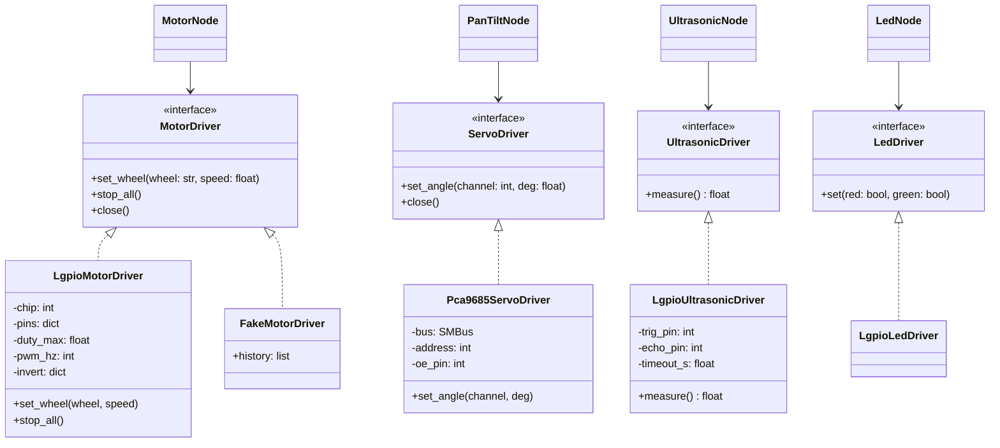
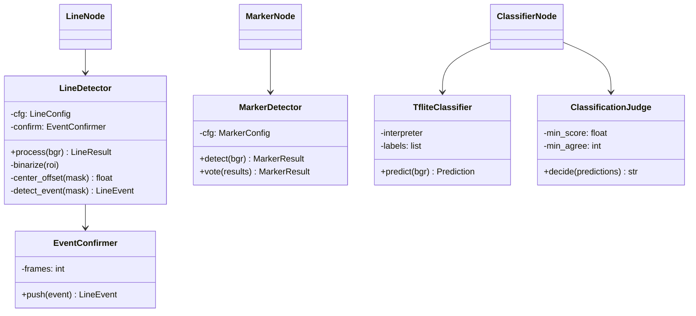
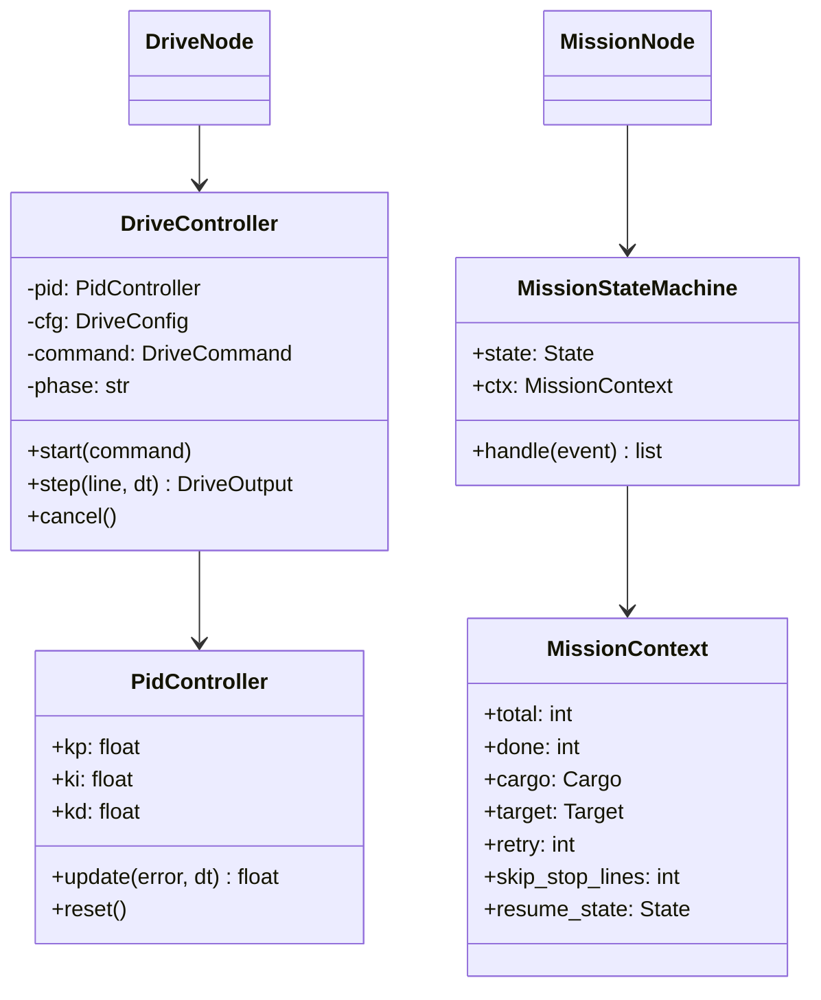
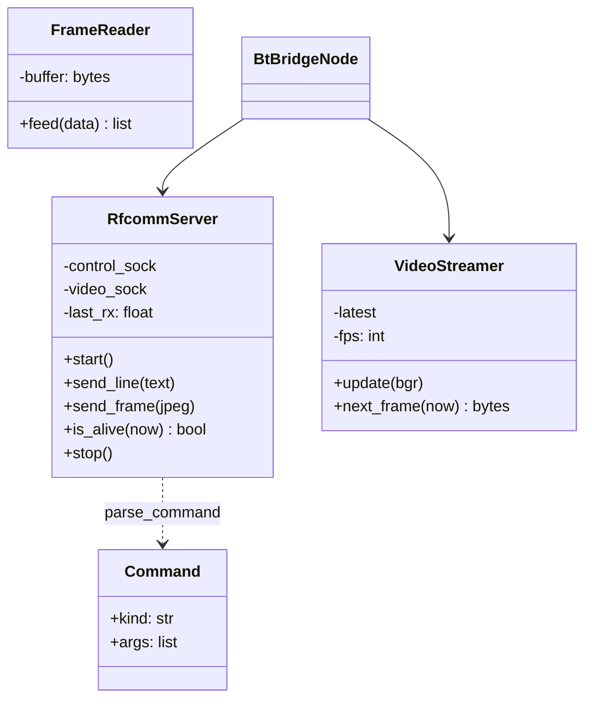
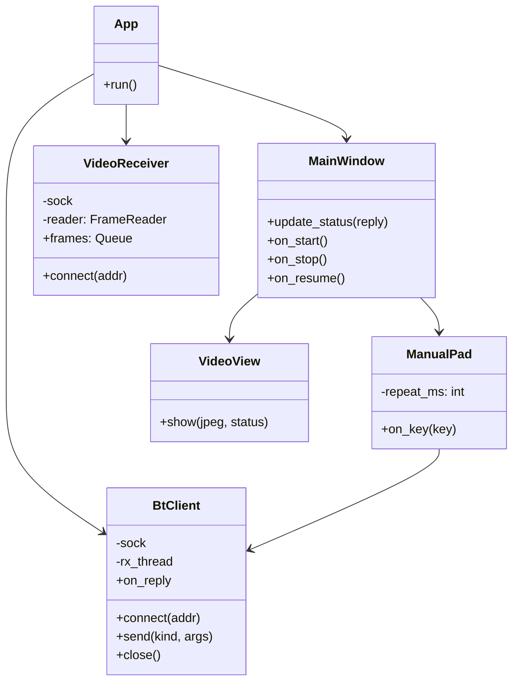
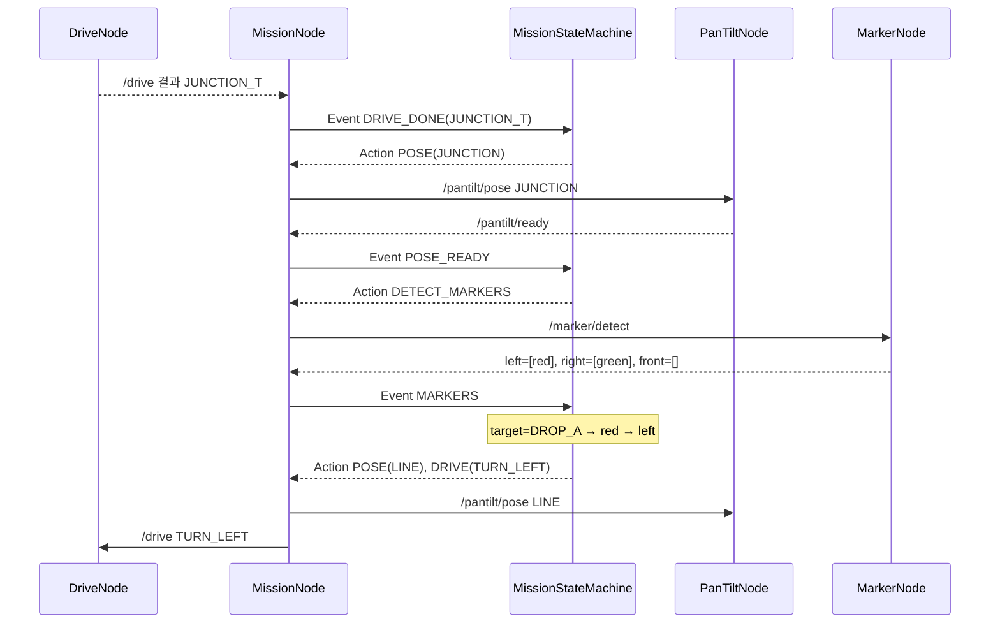
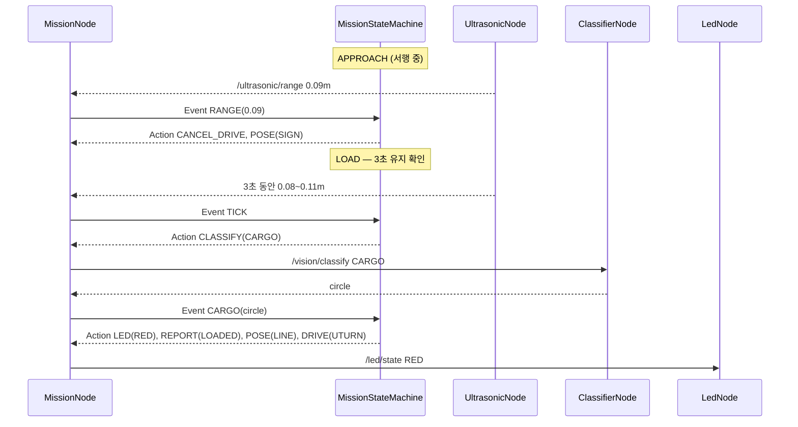

# 클래스 설계

> 기준: [소프트웨어 구조 설계](software_architecture.md)의 3계층(① 드라이버 / ② 순수 알고리즘 / ③ ROS 노드)과 모듈 배치
> 동작 규칙: [기능 설계서](functional_design.md) · 메시지: [블루투스 규약](../communication/bluetooth_protocol.md)
> 표기: Python 3.12 타입 힌트, 클래스 그림은 mermaid(GitHub에서 그림으로 표시)

---

## 0. 공통 타입 (`agv_protocol/types.py`)

여러 패키지(vision·control·bt·노트북 앱)가 함께 쓰는 이름은 문자열을 직접 쓰지 않고 열거형으로 정의한다. ROS 메시지에는 `.value` 문자열로 담는다.
패키지 사이 의존을 단순하게 하려고, 이미 모든 쪽이 쓰는 순수 Python 패키지 `agv_protocol`에 둔다.

```python
from enum import Enum
from dataclasses import dataclass, field

class Target(str, Enum):          # 목적지
    WORK = "WORK"; DROP_A = "DROP_A"; DROP_B = "DROP_B"; PARK = "PARK"

class Cargo(str, Enum):
    NONE = "NONE"; CIRCLE = "CIRCLE"; SQUARE = "SQUARE"

class Sign(str, Enum):            # 표지판 인식 결과
    WORK = "sign_work"; DROP_A = "sign_drop_a"; DROP_B = "sign_drop_b"; PARK = "sign_park"

class LineEvent(str, Enum):
    NONE = "NONE"; STOP_LINE = "STOP_LINE"; JUNCTION_T = "JUNCTION_T"
    JUNCTION_LEFT = "JUNCTION_LEFT"; JUNCTION_RIGHT = "JUNCTION_RIGHT"
    CORNER_LEFT = "CORNER_LEFT"; CORNER_RIGHT = "CORNER_RIGHT"; LINE_END = "LINE_END"

class DriveCommand(str, Enum):
    FOLLOW_TO_EVENT = "FOLLOW_TO_EVENT"; TURN_LEFT = "TURN_LEFT"; TURN_RIGHT = "TURN_RIGHT"
    STRAIGHT = "STRAIGHT"; UTURN = "UTURN"; APPROACH = "APPROACH"; STOP = "STOP"

class Pose(str, Enum):            # 팬틸트 자세
    LINE = "LINE"; JUNCTION = "JUNCTION"; SIGN = "SIGN"

class LedState(str, Enum):
    OFF = "OFF"; RED = "RED"; GREEN = "GREEN"; ERROR = "ERROR"

TARGET_COLOR = {Target.WORK: "blue", Target.DROP_A: "red", Target.DROP_B: "green", Target.PARK: "yellow"}
CARGO_TARGET = {Cargo.CIRCLE: Target.DROP_A, Cargo.SQUARE: Target.DROP_B}
CARGO_LED    = {Cargo.CIRCLE: LedState.RED, Cargo.SQUARE: LedState.GREEN}
SIGN_TARGET  = {Sign.WORK: Target.WORK, Sign.DROP_A: Target.DROP_A, Sign.DROP_B: Target.DROP_B, Sign.PARK: Target.PARK}
```

---

## 1. agv_hw — 하드웨어 드라이버 · 노드



### 1.1 드라이버 인터페이스 (`drivers/base.py`)
```python
from abc import ABC, abstractmethod

WHEELS = ("front_left", "rear_left", "front_right", "rear_right")

class MotorDriver(ABC):
    @abstractmethod
    def set_wheel(self, wheel: str, speed: float) -> None: ...   # speed: -1.0(후진) ~ 1.0(전진)
    @abstractmethod
    def stop_all(self) -> None: ...
    def close(self) -> None: self.stop_all()

class ServoDriver(ABC):
    @abstractmethod
    def set_angle(self, channel: int, deg: float) -> None: ...   # 0 ~ 180°
    def close(self) -> None: ...

class UltrasonicDriver(ABC):
    @abstractmethod
    def measure(self) -> float | None: ...                       # m, 실패 시 None

class LedDriver(ABC):
    @abstractmethod
    def set(self, red: bool, green: bool) -> None: ...
```

### 1.2 구현 클래스
| 클래스 | 생성자 인자 | 핵심 동작 |
|--------|------------|-----------|
| `LgpioMotorDriver` | `wheel_pins: dict[str, tuple[int,int]]`(바퀴 → (DIR, PWM)), `duty_max=0.75`, `pwm_hz=1000`, `invert: dict[str,bool]` | `speed` 부호 → DIR, `abs(speed)×duty_max` → `lgpio.tx_pwm` |
| `Pca9685ServoDriver` | `bus=1`, `address=0x40`, `oe_pin: int \| None = 17` | 시작 시 MODE1 설정·50Hz, OE LOW, 각도 → 펄스 폭(0.5~2.5ms) → 레지스터 쓰기 |
| `LgpioUltrasonicDriver` | `trig_pin=5`, `echo_pin=6`, `timeout_s=0.03` | Trig 10µs → Echo 상승~하강 시간 × 343/2 |
| `LgpioLedDriver` | `red_pin=16`, `green_pin=26` | `lgpio.gpio_write` |
| `FakeMotorDriver` 등 | 없음 | 호출 내용을 `history`에 기록, 초음파는 설정한 값 반환 |

- 바퀴 이름 ↔ L1~L4 매핑은 `params.yaml`의 `wheel_map`에서 읽어 `wheel_pins`를 만든다 (S0에서 확정)

### 1.3 노드
| 클래스 | 구독 / 발행 / 타이머 | 주요 메서드 |
|--------|---------------------|-------------|
| `MotorNode` | 구독 `/cmd_vel`, `/safety/estop` · 타이머 10Hz(워치독) | `on_cmd_vel(msg)` → `mix(x, z) -> (left, right)` → 바퀴 4개, `on_estop(msg)`, `on_watchdog()` |
| `PanTiltNode` | 구독 `/pantilt/pose` | `on_pose(msg)` → `poses[name]` 각도 적용 → 0.3초 후 `/pantilt/ready` 발행 |
| `UltrasonicNode` | 발행 `/ultrasonic/range` · 타이머 15Hz | `on_timer()` → `measure()` → `MedianFilter.push()` → 발행 |
| `LedNode` | 구독 `/led/state` · 타이머 2Hz(깜빡임) | `on_state(msg)`, `on_blink()` |

```python
class MedianFilter:                      # agv_hw/filters.py (순수 Python)
    def __init__(self, window: int = 5): ...
    def push(self, value: float | None) -> float | None: ...   # None·범위 밖 값은 버림
```

---

## 2. agv_vision — 영상 알고리즘 · 노드



### 2.1 결과·설정 데이터
```python
@dataclass
class LineResult:
    offset: float          # -1.0 ~ 1.0 (라인 중심 좌우 오차)
    line_found: bool
    event: LineEvent       # 확정된 이벤트 (연속 프레임 통과분만)

@dataclass
class MarkerResult:
    left: list[str] = field(default_factory=list)    # 예: ["red"]
    front: list[str] = field(default_factory=list)
    right: list[str] = field(default_factory=list)   # 예: ["blue", "yellow"]
    def as_dict(self) -> dict[str, list[str]]: ...

@dataclass
class Prediction:
    label: str
    score: float

@dataclass
class LineConfig:
    width: int = 320; height: int = 240
    roi_ratio: float = 0.33
    stop_line_width_ratio: tuple[float, float] = (2.0, 5.0)
    confirm_frames: int = 3

@dataclass
class MarkerConfig:
    hsv: dict[str, list[tuple[int,int,int,int,int,int]]]   # 색 → [(H하한,S하한,V하한,H상한,S상한,V상한), ...] (빨강은 범위 2개)
    zones: dict[str, tuple[float,float,float,float]]       # 갈래 → 화면 비율 영역 (x0,y0,x1,y1), back 포함
    min_area: int = 200
    vote_frames: int = 10
    vote_ratio: float = 0.7
```

### 2.2 알고리즘 클래스
| 클래스 | 메서드 | 내용 |
|--------|--------|------|
| `LineDetector` | `process(bgr) -> LineResult` | 축소 → 하단 ROI → 회색조 → Otsu 이진화(검정) → 오프셋 계산 → 이벤트 판정 → `EventConfirmer`로 연속 확인 |
| | `detect_event(mask) -> LineEvent` | 위쪽 행의 가로 폭·양끝 도달·앞쪽 라인 유무로 기능 설계서 F4 표에 따라 판정 |
| `EventConfirmer` | `push(event) -> LineEvent` | 같은 이벤트가 `frames`번 연속이면 반환, 아니면 `NONE` |
| `MarkerDetector` | `detect(bgr) -> MarkerResult` | HSV 마스크 → 열림 연산 → 면적 필터 → 중심 x·y로 left/front/right 분류, 아래 가운데(back = 들어온 갈래) 영역은 버림 |
| | `vote(results) -> MarkerResult` | 갈래·색별로 `vote_ratio` 이상 나온 것만 남김 |
| `TfliteClassifier` | `__init__(model_path, labels_path)`, `predict(bgr) -> Prediction` | 224×224 리사이즈 → LiteRT 추론 → 최고 점수 라벨 |
| `ClassificationJudge` | `decide(preds) -> str \| None` | `score ≥ 0.8`인 같은 라벨이 3개 이상이면 그 라벨, `background`거나 미달이면 `None` |

### 2.3 노드
| 클래스 | 구독 / 서비스 | 주요 메서드 |
|--------|--------------|-------------|
| `LineNode` | 구독 `/camera/image_raw`(최신 1장) → 발행 `/line/state`, 파라미터 `enabled` | `on_image(msg)` → `cv_bridge` 변환 → `detector.process()` → 발행 |
| `MarkerNode` | 구독 영상(최근 10장 링버퍼), 서비스 `/marker/detect` | `on_image()`, `on_detect(req, res)` → `vote([detect(f) for f in buffer])` |
| `ClassifierNode` | 구독 영상(최근 5장), 서비스 `/vision/classify` | `on_classify(req, res)` → 모드별 모델 선택 → `predict` × 5 → `judge.decide()` |

---

## 3. agv_control — 주행 · 상태 머신



### 3.1 주행
```python
@dataclass
class DriveConfig:
    speed: float = 0.4              # 기본 선속도 (-1~1 비율)
    approach_speed: float = 0.2
    turn_speed: float = 0.5
    pre_turn_forward_s: float = 0.3 # 회전 전 차체 반 길이 전진 시간
    turn_timeout_s: float = 3.0
    uturn_timeout_s: float = 6.0

@dataclass
class DriveOutput:
    linear: float                   # /cmd_vel x
    angular: float                  # /cmd_vel z
    done: bool = False
    result: str = ""                # 완료 이벤트 이름 또는 실패 사유 (예: "STOP_LINE", "E_TURN")
```

| 클래스 | 메서드 | 내용 |
|--------|--------|------|
| `PidController` | `update(error, dt) -> float`, `reset()` | 각속도 계산, 적분 제한 |
| `DriveController` | `start(command)` | 동작 시작, 단계(`phase`) 초기화 |
| | `step(line: LineResult, dt) -> DriveOutput` | 동작별 단계 진행 — FOLLOW: PID 주행, 이벤트 시 감속·정지 후 `done` / TURN·STRAIGHT: 전진 → 회전(직진은 생략) → 라인 중앙 도달 시 `done` / UTURN: 라인 두 번째 통과 시 `done` / APPROACH: 서행 PID, **라인 이벤트 무시** / 시간 초과 시 `result="E_TURN"` |
| | (내부) 이벤트 억제 | TURN·STRAIGHT·UTURN 완료 후 다음 FOLLOW에서 라인 이벤트가 사라질 때까지(최소 0.5초) 새 이벤트 무시 — 같은 분기점 재검출 방지 |
| | `cancel()` | 즉시 정지 출력 |

### 3.2 상태 머신
```python
class State(str, Enum):
    IDLE = "IDLE"; NAVIGATE = "NAVIGATE"; AT_JUNCTION = "AT_JUNCTION"; CHECK_SIGN = "CHECK_SIGN"
    APPROACH = "APPROACH"; LOAD = "LOAD"; UNLOAD = "UNLOAD"; UTURN = "UTURN"; PARKED = "PARKED"
    PAUSED_OBSTACLE = "PAUSED_OBSTACLE"; ERROR = "ERROR"; ESTOP = "ESTOP"; MANUAL = "MANUAL"

@dataclass
class Event:                      # 상태 머신 입력
    kind: str                     # 아래 이벤트 표
    data: dict = field(default_factory=dict)

@dataclass
class Action:                     # 상태 머신 출력 (MissionNode가 실행)
    kind: str                     # 아래 동작 표
    data: dict = field(default_factory=dict)

@dataclass
class MissionContext:
    total: int = 0
    done: int = 0
    cargo: Cargo = Cargo.NONE
    target: Target = Target.WORK
    retry: int = 0
    skip_stop_lines: int = 0      # LOAD 후 1 → 작업장 정지선 통과
    resume_state: State | None = None   # ESTOP·ERROR·PAUSED 후 돌아갈 상태
    hold_since: float | None = None     # 적재 거리 유지 시작 시각

class MissionStateMachine:
    def __init__(self, cfg: MissionConfig): ...
    def handle(self, event: Event) -> list[Action]: ...   # 순수 함수처럼 동작 (시간은 event로 전달)
```
- START: `IDLE` → `UTURN` (출발 위치에서 표지판을 보고 서 있으므로) → `NAVIGATE`
- `DRIVE_DONE(STOP_LINE)` 수신 시 `skip_stop_lines > 0`이면 1 줄이고 `DRIVE(FOLLOW_TO_EVENT)` 재요청
- `AT_JUNCTION`: 기능 설계서의 NAVIGATE 안에서 분기점 처리 단계를 별도 상태로 분리 (마커 요청 → 응답 대기)

**이벤트 (MissionNode → 상태 머신)**
| kind | data | 발생 |
|------|------|------|
| `START` | `total` | BT 명령 |
| `STOP` / `RESUME` | — | BT 명령 |
| `MANUAL_ON` / `MANUAL_OFF` | — | BT 명령 |
| `DRIVE_DONE` | `result`(STOP_LINE·JUNCTION_*·CORNER_*·TURN_DONE·UTURN_DONE·E_TURN·E_LINE) | `/drive` 액션 결과 |
| `MARKERS` | `left`, `front`, `right` | `/marker/detect` 응답 |
| `SIGN` | `label` 또는 `None` | `/vision/classify SIGN` 응답 |
| `CARGO` | `label` 또는 `None` | `/vision/classify CARGO` 응답 |
| `RANGE` | `distance`, `now` | `/ultrasonic/range` |
| `POSE_READY` | — | 팬틸트 안정화 완료 |
| `TICK` | `now` | 타이머 (시간 조건 처리) |

**동작 (상태 머신 → MissionNode)**
| kind | data | 실행 |
|------|------|------|
| `DRIVE` | `command` | `/drive` 액션 목표 전송 |
| `CANCEL_DRIVE` | — | 액션 취소 + 정지 |
| `POSE` | `pose` | `/pantilt/pose` |
| `LED` | `state` | `/led/state` |
| `DETECT_MARKERS` | — | `/marker/detect` 호출 |
| `CLASSIFY` | `mode` | `/vision/classify` 호출 |
| `ESTOP` | `on` | `/safety/estop` |
| `REPORT` | `event` / `error`, `message` | BT로 EVENT·ERROR 전송 (bt_bridge 경유) |

**전이 예시 (분기점)**
| 현재 상태 | 이벤트 | 동작 | 다음 상태 |
|-----------|--------|------|-----------|
| NAVIGATE | `DRIVE_DONE(JUNCTION_T)` | `POSE(JUNCTION)` | AT_JUNCTION |
| AT_JUNCTION | `POSE_READY` | `DETECT_MARKERS` | AT_JUNCTION |
| AT_JUNCTION | `MARKERS` → `choose_branch` 성공 | `POSE(LINE)`, `DRIVE(TURN_LEFT 등)` | NAVIGATE |
| AT_JUNCTION | `MARKERS` → `MarkerError` | `LED(ERROR)`, `REPORT(error=E_MARKER)` | ERROR |

```python
class MarkerError(Exception): ...

def choose_branch(markers: MarkerResult, target: Target) -> DriveCommand:   # branch_selector.py
    color = TARGET_COLOR[target]
    hits = [name for name, colors in markers.as_dict().items() if color in colors]
    if len(hits) != 1:
        raise MarkerError(f"{color} 갈래 {len(hits)}개")
    return {"left": DriveCommand.TURN_LEFT, "front": DriveCommand.STRAIGHT,
            "right": DriveCommand.TURN_RIGHT}[hits[0]]
```

### 3.3 노드
| 클래스 | 구성 | 주요 메서드 |
|--------|------|-------------|
| `DriveNode` | 액션 서버 `/drive`, 구독 `/line/state`, 발행 `/cmd_vel`, 20Hz 타이머 | `on_goal(goal)` → `controller.start()`, `on_line(msg)`, `on_timer()` → `step()` → `/cmd_vel`, 완료 시 결과 반환 |
| `MissionNode` | 구독 `/mission/command`, `/ultrasonic/range`, `/pantilt/ready` · 발행 `/pantilt/pose`, `/led/state`, `/mission/status`, `/safety/estop` · 액션 클라이언트 `/drive` · 서비스 클라이언트 2개 · 10Hz 타이머 | 콜백마다 `Event` 생성 → `sm.handle()` → `execute(actions)` → 상태 바뀌면 `/mission/status` 발행 |

---

## 4. agv_protocol / agv_bt — 블루투스



### 4.1 agv_protocol (순수 Python — 차량·노트북 공용)
```python
@dataclass
class Command:
    kind: str                     # START / STOP / RESUME / MANUAL / MOVE / PING
    args: list[str] = field(default_factory=list)

def parse_command(line: str) -> Command: ...            # 형식 오류 시 ValueError
def format_command(kind: str, *args) -> str: ...        # 노트북 쪽 사용
def format_status(state, done, total, cargo, target) -> str: ...
def format_event(kind: str, detail: str = "") -> str: ...
def format_error(code: str, detail: str = "") -> str: ...
def parse_reply(line: str) -> dict: ...                 # 노트북 쪽: STATUS/EVENT/ERROR/ACK/NAK/PONG 해석

def pack_frame(jpeg: bytes) -> bytes: ...               # 4바이트 길이(big-endian) + JPEG
class FrameReader:
    def feed(self, data: bytes) -> list[bytes]: ...     # 받은 조각을 모아 완성된 JPEG 목록 반환
```

### 4.2 agv_bt
| 클래스 | 메서드 | 내용 |
|--------|--------|------|
| `RfcommServer` | `start()` | 채널 1·2 소켓 열고 수락 스레드 시작 |
| | `on_line: Callable[[str], None]` | 채널 1에서 한 줄 받을 때마다 호출되는 콜백 (노드가 지정) |
| | `send_line(text)`, `send_frame(jpeg)` | 연결 없으면 무시, 영상 전송은 이전 전송이 끝나지 않았으면 건너뜀 |
| | `is_alive(now) -> bool` | 마지막 수신 후 1.5초 이내인지 |
| `VideoStreamer` | `update(bgr)`, `next_frame(now) -> bytes \| None` | 최신 프레임만 보관, 0.2초 간격으로 320×240 JPEG 생성 |
| `BtBridgeNode` | 구독 `/mission/status`, 영상 · 발행 `/mission/command`, `/safety/estop` · 타이머 | `on_line(text)` → `STOP`이면 즉시 estop 발행 후 명령 전달, `on_status(msg)` → `format_status` 전송, `on_timer()` → 하트비트 검사·영상 전송 |

---

## 5. laptop_app — 노트북 앱



| 클래스 | 책임 |
|--------|------|
| `App` | 설정(Pi 블루투스 주소) 읽기, 객체 생성·연결, tkinter 메인 루프 |
| `BtClient` | 채널 1 연결, 수신 스레드(`parse_reply` → `on_reply` 콜백), 0.5초 PING 타이머, `send("START", 3)` |
| `VideoReceiver` | 채널 2 수신 스레드 → `FrameReader.feed` → 큐 (최신 1장 유지) |
| `MainWindow` | 연결 버튼, 작업 횟수 입력·시작, **비상 정지 버튼(크게, 스페이스바)**, 재개, 상태 표시 |
| `VideoView` | 큐에서 JPEG 꺼내 표시 + 현재 상태 문구 겹쳐 그리기 (30ms 주기) |
| `ManualPad` | 방향 버튼·W/A/S/D → `MOVE v w`를 0.3초마다 반복, 키를 떼면 `MOVE 0 0` |

- 수신 스레드에서 화면을 직접 건드리지 않고 `root.after()`로 메인 스레드에 넘긴다 (tkinter 규칙)

---

## 6. 동작 흐름 예시 (시퀀스)

### 분기점에서 하차 A 갈래 선택


### 작업장 적재


---

## 7. 단위 테스트 대상 (`test/`)

| 클래스·함수 | 테스트 예 |
|-------------|-----------|
| `LineDetector` | 직선·코너·T자·정지선 사진 → 기대 이벤트, 오프셋 부호 |
| `MarkerDetector` | 4색·2색 패치 사진 → 갈래별 색 목록 |
| `ClassificationJudge` | 점수 목록 → 확정/미확정 |
| `PidController` | 계단 입력 → 출력 방향·크기 |
| `DriveController` | 가짜 LineResult 순서 → 단계 전이, 시간 초과 |
| `choose_branch` | 6가지 분기 상황(테스트 트랙 S10 판단표) + 마커 0개·2개 오류 |
| `MissionStateMachine` | 1사이클 이벤트 순서 → 기대 동작 목록, 장애물·비상 정지·오류 경로 |
| `agv_protocol` | 명령·응답 문자열 왕복, 프레임 분할 수신 |
| `MedianFilter` | None·이상값 제거 |
