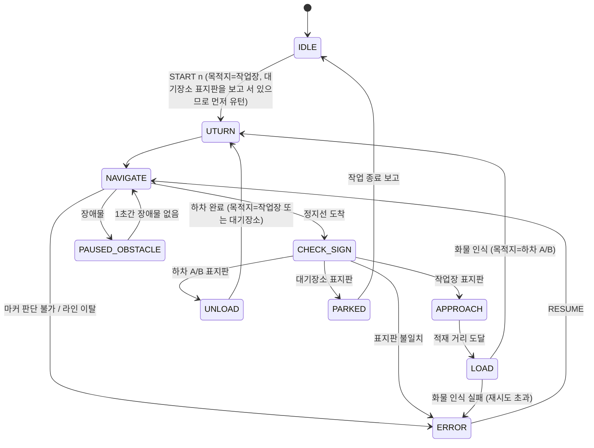

# 기능 설계서 — 차량 소프트웨어 (ROS 2)

> 대상 하드웨어: PiCar-R5 키트(Raspberry Pi 5, DRV8835 × 2, PCA9685, TT 모터 4개, 팬틸트) + Camera Module 3 Wide + 브레드보드(초음파, LED 2개)
> 소프트웨어: Ubuntu 24.04 LTS · ROS 2 Jazzy · Python(rclpy) / 노트북 Python 앱
> 관련 문서: [핀맵](../hardware/pinmap.md) · [배선도](../hardware/wiring.md) · [테스트 트랙](../track/test_track.md) · [블루투스 규약](../communication/bluetooth_protocol.md) · [AI 클래스](../ai/tm_classes.md)

---

## 1. 기능 ↔ 하드웨어 대응

| # | 기능 | 하드웨어 | 담당 노드 | 검증 단계 |
|---|------|----------|-----------|:---:|
| F1 | 영상 획득 | Camera Module 3 Wide (IMX708, CSI) | `camera_ros` (기존 패키지) | S0 |
| F2 | 카메라 각도 전환 | SG90 × 2 ← PCA9685 (I2C) | `pantilt_node` | S0, S6 |
| F3 | 모터 구동 | TT 모터 4개 ← DRV8835 × 2 (GPIO 18~25) | `motor_node` | S0 |
| F4 | 라인 추종·이벤트 검출 | 카메라 | `line_node` + `drive_node` | S1~S3 |
| F5 | 직각 회전·유턴 | 모터 + 카메라 | `drive_node` | S2, S8 |
| F6 | 색 마커 판별 | 카메라 | `marker_node` | S4, S5 |
| F7 | 화물·표지판 인식 (AI) | 카메라 | `classifier_node` | S6, S7 |
| F8 | 거리 측정 (적재·장애물) | HC-SR04 (GPIO 5·6) | `ultrasonic_node` | S0, S7, S9 |
| F9 | 적재 상태 표시 | LED 빨강·초록 (GPIO 16·26) | `led_node` | S0, S7 |
| F10 | 블루투스 제어·상태 보고 | Pi 5 내장 BT | `bt_bridge_node` | S0, S10 |
| F11 | 블루투스 영상 전송 | Pi 5 내장 BT | `bt_bridge_node` | S0 |
| F12 | 물류 처리 (상태 머신) | — | `mission_node` | S10 |
| F13 | (옵션) LCD 작업 횟수 | I2C LCD (GPIO 2·3 공유) | `lcd_node` | — |

---

## 2. 시스템 구조

```
 ┌──────────────────────── Raspberry Pi 5 (ROS 2 Jazzy) ────────────────────────┐
 │                                                                              │
 │  camera_ros ──/camera/image_raw──┬──► line_node ──/line/state──► drive_node  │
 │                                  ├──► marker_node   (서비스)        │  ▲      │
 │                                  ├──► classifier_node (서비스)      │  │      │
 │                                  └──► bt_bridge_node (영상)     /cmd_vel│      │
 │                                                                    ▼  │      │
 │  ultrasonic_node ──/ultrasonic/range──► mission_node ◄────────► motor_node   │
 │                                         │  ▲   │                             │
 │  pantilt_node ◄──/pantilt/pose──────────┘  │   └──/led/state──► led_node     │
 │                                            │                                 │
 │  bt_bridge_node ◄──/mission/status─────────┘                                 │
 │       │  └──/mission/command, /safety/estop──►                               │
 └───────┼──────────────────────────────────────────────────────────────────────┘
         │ Bluetooth RFCOMM (채널 1: 제어 / 채널 2: 영상)
 ┌───────┴──────── 노트북 Python 앱 ────────┐
 │  작업 횟수 입력 · 비상 정지 · 수동 제어 · 상태 표시 · 영상 표시 │
 └──────────────────────────────────────────┘
```

- `mission_node`가 전체 흐름(상태 머신)을 결정하고, `drive_node`는 "라인 따라가기·회전" 같은 주행 동작만 수행
- 영상 처리는 필요한 노드만 켠다: 주행 중 `line_node`, 정지 중 `marker_node`/`classifier_node` (서비스 호출 시에만 처리)

---

## 3. ROS 2 패키지 구성 (`ros2_ws/src/`)

> 모듈·클래스·계층 구조는 [소프트웨어 구조 설계](software_architecture.md)

| 패키지 | 빌드 | 내용 |
|--------|------|------|
| `agv_interfaces` | ament_cmake | 사용자 정의 메시지·서비스 (`.msg`, `.srv`) — 인터페이스 패키지는 CMake 필수 |
| `agv_hw` | ament_python | `motor_node`, `pantilt_node`, `ultrasonic_node`, `led_node` (lgpio, smbus2) |
| `agv_vision` | ament_python | `line_node`, `marker_node`, `classifier_node` (OpenCV, LiteRT) |
| `agv_control` | ament_python | `drive_node`, `mission_node` |
| `agv_bt` | ament_python | `bt_bridge_node` (Python socket RFCOMM) |
| `agv_protocol` | ament_python | 블루투스 메시지 만들기·해석 (순수 Python, 노트북 앱도 같은 코드 사용) |
| `agv_bringup` | ament_python | launch 파일, 파라미터(`params.yaml`), 모델 파일 |

---

## 4. 토픽 · 서비스 · 액션

### 토픽
| 이름 | 타입 | 발행 → 구독 | 주기 | 내용 |
|------|------|-------------|------|------|
| `/camera/image_raw` | sensor_msgs/Image | camera_ros → vision, bt | 15~30Hz | 카메라 영상 |
| `/line/state` | agv_interfaces/LineState | line_node → drive_node | 영상 주기 | 라인 오프셋, 이벤트 |
| `/cmd_vel` | geometry_msgs/Twist | drive_node·mission(수동) → motor_node | 20Hz | 선속도 x, 각속도 z |
| `/ultrasonic/range` | sensor_msgs/Range | ultrasonic_node → mission_node | 15Hz | 거리(m), 필터 적용 |
| `/pantilt/pose` | std_msgs/String | mission_node → pantilt_node | 이벤트 | `LINE` / `JUNCTION` / `SIGN` |
| `/pantilt/ready` | std_msgs/String | pantilt_node → mission_node | 이벤트 | 자세 변경 후 안정화 완료 (자세 이름) |
| `/led/state` | std_msgs/String | mission_node → led_node | 이벤트 | `OFF` / `RED` / `GREEN` / `ERROR` |
| `/mission/command` | agv_interfaces/Command | bt_bridge → mission_node | 이벤트 | START n, STOP, RESUME, MANUAL, MOVE |
| `/mission/status` | agv_interfaces/Status | mission_node → bt_bridge | 2Hz + 변화 시 | 상태, 작업 횟수, 화물, 목적지 |
| `/safety/estop` | std_msgs/Bool | bt_bridge·mission → motor_node | 이벤트 | 비상 정지 래치 |
| `/dev/wheels` | std_msgs/Float32MultiArray | bt_bridge → motor_node | 0.3초 반복 | 개발자 탭: L1~L4 듀티 (-1~1), 워치독 적용 |
| `/dev/pantilt_angle` | std_msgs/Float32MultiArray | bt_bridge → pantilt_node | 이벤트 | 개발자 탭: [팬, 틸트] 각도 |

### 서비스 / 액션
| 이름 | 종류 | 제공 | 요청 → 응답 |
|------|------|------|-------------|
| `/drive` | 액션 `agv_interfaces/Drive` | drive_node | 동작(`FOLLOW_TO_EVENT`, `TURN_LEFT`, `TURN_RIGHT`, `STRAIGHT`, `UTURN`, `APPROACH`, `STOP`) → 결과 이벤트·성공 여부 |
| `/marker/detect` | 서비스 `agv_interfaces/DetectMarkers` | marker_node | (없음) → 갈래별 색 목록 `left[]`, `front[]`, `right[]` |
| `/vision/classify` | 서비스 `agv_interfaces/Classify` | classifier_node | 모드(`CARGO` / `SIGN`) → 라벨, 신뢰도 |

### 사용자 정의 메시지 (agv_interfaces)
```
# LineState.msg
float32 offset          # 라인 중심의 좌우 오차 (-1.0 ~ 1.0)
bool    line_found
string  event           # NONE / STOP_LINE / JUNCTION_T / JUNCTION_LEFT / JUNCTION_RIGHT
                        # CORNER_LEFT / CORNER_RIGHT / LINE_END
string  raw_event       # 이번 프레임 판정 (연속 프레임 확인 전) — 검출 값 조정용

# Status.msg
string state            # 상태 머신 상태 이름
uint8  done             # 완료한 작업 수
uint8  total            # 입력한 작업 수
string cargo            # NONE / CIRCLE / SQUARE
string target           # WORK / DROP_A / DROP_B / PARK
string message          # 오류·알림 문구

# Command.msg  (bt_bridge → mission_node)
string kind             # START / STOP / RESUME / MANUAL_ON / MANUAL_OFF / MOVE
uint8  total            # START일 때 작업 횟수
float32 linear          # MOVE일 때 선속도 (-1.0 ~ 1.0)
float32 angular         # MOVE일 때 회전 (-1.0 ~ 1.0)

# Drive.action
string command          # FOLLOW_TO_EVENT / TURN_LEFT / TURN_RIGHT / STRAIGHT / UTURN / APPROACH / STOP
---
bool   success
string result           # 끝난 이유: STOP_LINE / JUNCTION_* / CORNER_* / TURN_DONE / UTURN_DONE / STOPPED / E_TURN / E_LINE
---
float32 offset          # 진행 중 피드백: 현재 라인 오프셋

# DetectMarkers.srv
---
string[] left
string[] front
string[] right
bool     ok             # 영상 프레임 부족 등으로 판별 못 하면 false

# Classify.srv
string mode             # CARGO / SIGN
---
string label            # 확정 라벨, 미확정이면 빈 문자열
float32 score
```

---

## 5. 상태 머신 (`mission_node`)



- **공통 상태 (모든 상태에서 진입)**: `ESTOP`(BT 비상 정지·연결 끊김 → 모터 정지, RESUME 시 이전 상태로), `MANUAL`(BT 수동 제어, 해제 시 IDLE)
- `NAVIGATE`는 목적지(`target`)를 가지고 정지선에 도착할 때까지 라인 추종 + 분기점 판단을 반복하는 상위 상태 (구현에서는 분기점 처리를 `AT_JUNCTION` 상태로 분리 — [클래스 설계](class_design.md) 3.2)

### 상태별 동작
| 상태 | 진입 시 동작 | 종료 조건 | 다음 |
|------|-------------|-----------|------|
| IDLE | 모터 정지, LED OFF, 팬틸트 LINE | START n 수신 | target=WORK → UTURN (출발 위치 = 대기장소 정지선, 표지판 방향) |
| NAVIGATE | 팬틸트 LINE, `/drive FOLLOW_TO_EVENT` | 이벤트 수신 | 아래 6절 |
| CHECK_SIGN | 정지, 팬틸트 SIGN, `/vision/classify SIGN` | 표지판 확인 | 표지판 = 기대 목적지 → 해당 상태 / 불일치 → ERROR |
| APPROACH | 팬틸트 LINE, `/drive APPROACH`(서행, **라인 이벤트 무시** — 방금 멈춘 작업장 정지선 위를 지나가므로) | 초음파 ≤ 적재 거리 | LOAD |
| LOAD | 정지, 3초 동안 거리 유지 확인 + 팬틸트 SIGN, `/vision/classify CARGO` | 3초 유지 + 화물 확정 | LED RED/GREEN, target = DROP_A/B, **skip_stop_lines = 1**(돌아 나가며 작업장 정지선을 다시 지남) → UTURN |
| UNLOAD | 정지, LED OFF, 2초 대기(하차 연출), done += 1 | 대기 끝 | target = (done < total ? WORK : PARK) → UTURN |
| UTURN | 팬틸트 LINE, `/drive UTURN` | 라인 재인식 | NAVIGATE |
| PARKED | 정지, 완료 보고(BT) | 보고 완료 | IDLE |
| PAUSED_OBSTACLE | 정지, 상태 보고 | 1초 연속 장애물 없음 | 이전 동작 재개 |
| ERROR | 정지, LED ERROR(깜빡임), BT로 오류 코드 전송 | RESUME | 이전 상태 재시도 |

---

## 6. 주행 · 분기점 판단

### NAVIGATE 처리 흐름
```
FOLLOW_TO_EVENT ─► 이벤트?
   ├ CORNER_LEFT / CORNER_RIGHT ─► 정지 → 같은 방향 90° 회전 → FOLLOW 재개
   ├ JUNCTION_* ─► 정지 → 팬틸트 JUNCTION → /marker/detect → 갈래 선택 → 회전/직진 → FOLLOW 재개
   ├ STOP_LINE ─► skip_stop_lines > 0 이면 1 줄이고 통과 / 아니면 정지 → CHECK_SIGN
   └ LINE_END (정지선 없이 끝) / 라인 이탈 ─► ERROR
```

### 이벤트 중복 검출 방지
| 상황 | 문제 | 규칙 |
|------|------|------|
| 작업장에서 적재 후 유턴 | 이미지판과 분기점 사이의 **작업장 정지선**을 다시 지나며 CHECK_SIGN에 잘못 들어감 | LOAD에서 `skip_stop_lines = 1` → 다음 정지선 1개 통과 |
| 작업장 정지선 → 이미지판 접근 | 멈춘 정지선 위를 바로 지나감 | APPROACH 중에는 라인 이벤트 무시 |
| 분기점에서 직진·회전 직후 | 같은 분기점의 가로 라인을 다시 이벤트로 검출 | `drive_node`는 STRAIGHT·TURN 완료 후 라인 이벤트가 사라질 때까지(최소 0.5초) 새 이벤트 무시 |
| 하차 지점·대기장소 유턴 | 정지선이 유턴 후 차량 뒤쪽에 있음 | 규칙 불필요 (S8에서 확인) |

### 분기점 갈래 선택 (색 마커 규칙)
```python
TARGET_COLOR = {"WORK": "blue", "DROP_A": "red", "DROP_B": "green", "PARK": "yellow"}

def choose_branch(markers, target):          # markers: {"left": [...], "front": [...], "right": [...]}
    color = TARGET_COLOR[target]
    hits = [b for b, colors in markers.items() if color in colors]
    if len(hits) != 1:
        raise MarkerError(f"{color} 마커 갈래 {len(hits)}개")   # → ERROR 상태
    return {"left": "TURN_LEFT", "front": "STRAIGHT", "right": "TURN_RIGHT"}[hits[0]]
```
- 들어온 갈래(뒤쪽) 마커가 화면 아래쪽에 보일 수 있음 → 화면 아래 가운데 영역(back)은 판별에서 제외 (영역 경계는 S5에서 보정)
- 마커 판별은 여러 프레임 다수결(예: 10프레임 중 7프레임 이상 일치)

---

## 7. 기능별 상세 설계

### F1 · 영상 획득 (`camera_ros`)
- 카메라: Raspberry Pi Camera Module 3 Wide (IMX708, 대각 약 120° 광각, 자동 초점)
- 출력 640×480 → 노드마다 필요한 크기로 축소 (라인 320×240, AI 224×224, BT 영상 320×240)
- **초점**: 주행 중 자동 초점이 흔들리면 라인 검출이 불안정 → 자세별 고정 초점(LINE·JUNCTION·SIGN 각각 렌즈 위치 값)으로 운용, S0·S6에서 값 결정
- **광각 왜곡**: 화면 가장자리가 휘어 보임 → 라인 추종은 화면 아래 중앙 관심 영역만 사용, 마커 위치 판단에 문제가 되면 왜곡 보정(카메라 보정 1회) 적용
- 광각 덕분에 분기점에서 좌·앞·우 갈래 마커를 한 화면에 담기 쉬움

### F2 · 팬틸트 (`pantilt_node`)
- PCA9685(I2C 0x40 기본) 채널 = 서보 헤더 번호(조립 시 확정), 50Hz
- 자세 3가지 (각도는 S0·S6에서 보정, `params.yaml`)
  | 자세 | 용도 | 틸트 |
  |---|---|---|
  | LINE | 주행 중 라인·정지선·분기점 검출 | 아래 |
  | JUNCTION | 분기점에서 갈래 마커 보기 | 약간 아래 (갈래 3개가 한 화면에) |
  | SIGN | 표지판·화물 인식 | 정면 |
- 자세 변경 후 0.3초 안정화 대기
- GPIO17: 제어 없이 서보 동작 확인(2026-10-26) → 필수 아님. 드라이버는 안전하게 시작 시 LOW 출력(OE라면 출력 활성, 아니면 영향 없음)

### F3 · 모터 (`motor_node`)
- 입력 `/cmd_vel`(x: 선속도, z: 각속도) → 좌우 속도 = x ∓ z·k → 같은 쪽 바퀴 2개는 같은 값
- lgpio 소프트웨어 PWM 1kHz, DIR 핀으로 방향, **듀티 상한 75%**(TT 모터 보호, 파라미터)
- 바퀴 위치·방향 보정표(`params.yaml`): L1~L4 → 좌전·좌후·우전·우후, 극성 반전 여부 (S0에서 확정)
- 안전: `/cmd_vel` 0.5초 이상 끊기면 정지(워치독), `/safety/estop` true면 래치 정지

### F4 · 라인 추종 (`line_node` + `drive_node`)
- 처리: 영상 320×240으로 축소 → 하단 1/3 관심 영역 → 회색조 → 이진화(검정 추출, Otsu) → 윤곽선
- 오프셋: 관심 영역 아래쪽 행의 라인 중심 x → -1.0 ~ 1.0
- 이벤트 검출 (위쪽 행 기준)
  | 이벤트 | 판단 |
  |---|---|
  | STOP_LINE | 가로 검은 폭이 라인 폭의 2~5배 (짧은 가로선) |
  | JUNCTION_T | 가로 검은 영역이 화면 양끝까지 + 앞쪽 라인 없음 |
  | JUNCTION_LEFT / RIGHT | 앞쪽 라인 있음 + 한쪽으로 가로 라인이 화면 끝까지 |
  | CORNER_LEFT / RIGHT | 앞쪽 라인 없음 + 한쪽으로만 가로 라인 |
  | LINE_END | 관심 영역에 라인 없음 |
- `drive_node` PID: 각속도 z = Kp·e + Kd·Δe (Ki는 필요 시), 선속도는 오차가 크면 감속. 이벤트 검출 시 감속 → 정지
- 같은 이벤트가 연속 3프레임 이상일 때만 확정 (노이즈 방지)

### F5 · 직각 회전·유턴 (`drive_node`)
- TURN_LEFT/RIGHT: 정지선/분기점 위치에서 차체 반 길이 전진 → 제자리 회전(좌우 반대 방향) → 회전 중 라인이 화면 중앙에 들어오면 정지 → FOLLOW
- UTURN: 같은 방식으로 회전, 한 번 라인을 지나친 뒤 두 번째로 중앙에 오면 정지 (180°)
- 안전 시간 제한: 90° 회전 3초 / 유턴 6초 넘으면 실패 → ERROR
- 회전 속도·전진 거리는 S2·S8에서 보정

### F6 · 색 마커 판별 (`marker_node`)
- 팬틸트 JUNCTION 자세에서 호출
- HSV 범위로 4색 마스크 → 잡음 제거(열림 연산) → 면적 기준 이상 덩어리만 마커로 인정
- 마커 중심 위치로 갈래 분류: 화면 왼쪽 영역 = left, 위쪽 중앙 = front, 오른쪽 = right, **아래쪽 중앙 = back(들어온 갈래, 제외)**
- 10프레임 다수결, 결과 `{left: [...], front: [...], right: [...]}`
- HSV 범위는 S4에서 조명 2가지로 보정해 `params.yaml`에 저장

### F7 · 화물·표지판 인식 (`classifier_node`)
- Teachable Machine 이미지 모델 → TFLite 변환 → LiteRT(`ai-edge-litert`)로 추론, 입력 224×224
- 모델 2개: 모드 CARGO → `cargo.tflite`(`circle` / `square` / `background`), 모드 SIGN → `sign.tflite`(`sign_work` / `sign_drop_a` / `sign_drop_b` / `sign_park` / `background`)
- 5프레임 연속 추론 → 신뢰도 0.8 이상이 3회 이상 같은 라벨이면 확정, 아니면 실패
- 화물 인식 실패 시 2회 재시도 → 그래도 실패면 ERROR(BT 알림) — 클래스 상세는 [tm_classes.md](../ai/tm_classes.md)

### F8 · 초음파 (`ultrasonic_node`, 해석은 `mission_node`)
- 15Hz 측정(Trig 10µs 펄스 → Echo 펄스 폭), 이동 중앙값 필터 5개, 범위 밖(2cm 미만·200cm 초과)은 무시
- 해석은 상태에 따라 다름
  | 상태 | 해석 | 기준 (파라미터, S7·S9에서 보정) |
  |---|---|---|
  | APPROACH / LOAD | 적재 거리 | 거리 ≤ 10cm 를 3초 유지 (±2cm) |
  | NAVIGATE, UTURN | 장애물 | 거리 ≤ 15cm → PAUSED_OBSTACLE, 1초 연속 해제 시 재개 |
  | 기타 | 무시 | — |
- **배치 제약**: 정지선에 멈췄을 때 차량 앞~표지판(또는 이미지판) 거리가 장애물 거리보다 짧으면, 정지선에 닿기 전에 표지판을 장애물로 보고 멈춘다 → **표지판·이미지판은 정지선에서 장애물 거리 + 10cm 이상(초기 25cm) 떨어뜨린다**

### F9 · LED (`led_node`)
| 명령 | 빨강 GPIO16 | 초록 GPIO26 |
|---|---|---|
| OFF (빈 차) | 끔 | 끔 |
| RED (원 적재) | 켬 | 끔 |
| GREEN (사각형 적재) | 끔 | 켬 |
| ERROR | 0.5초 간격 둘 다 깜빡임 | 〃 |

### F10·F11 · 블루투스 (`bt_bridge_node`)
- RFCOMM 서버, **채널 1 제어 / 채널 2 영상** 분리 → 영상이 밀려도 제어 명령은 지연되지 않음
- 하트비트: 노트북이 0.5초마다 PING, 1.5초 동안 아무 수신이 없으면 연결 끊김 → `/safety/estop` true
  - 부팅 후 **첫 연결 전에는 감시하지 않음** (차량은 IDLE로 정지 상태라 안전, START는 연결 후에만 가능)
- 비상 정지 해제: `/safety/estop` true는 `motor_node`에 래치되고, RESUME 시 `mission_node`가 false를 발행해야만 풀린다
- 영상: `/camera/image_raw` → 320×240 JPEG(품질 50) → 초당 5프레임, 보낼 차례에 최신 프레임만 전송(밀린 프레임 버림)
- 메시지 형식은 [bluetooth_protocol.md](../communication/bluetooth_protocol.md)

---

## 8. 예외 처리 대응

| 상황 | 감지 | 대응 | 복귀 |
|------|------|------|------|
| 장애물 | 주행 중 초음파 ≤ 15cm | PAUSED_OBSTACLE (정지) | 1초간 장애물 없음 → 자동 재개 |
| 블루투스 끊김 | 1.5초 무수신 | ESTOP (모터 정지) | 재연결 + RESUME |
| 비상 정지 | BT `STOP` | ESTOP | RESUME |
| 화물 인식 실패 | 재시도 2회 실패 | ERROR + BT 알림 | 화물 정리 후 RESUME |
| 마커 판단 불가 | 목적지 색 갈래 ≠ 1개 | ERROR + BT 알림 | 마커 정리 후 RESUME |
| 표지판 불일치 (옵션) | 기대 목적지와 다른 표지판 | ERROR + BT 알림 | 수동으로 차량 이동 후 RESUME |
| 라인 이탈 (옵션) | LINE_END/라인 없음 1초 | 정지 → 좌우로 천천히 탐색(2초) → 실패 시 ERROR | RESUME |
| 회전 실패 | 회전 시간 제한 초과 | ERROR | RESUME |

---

## 9. 운용 규칙
| 항목 | 규칙 |
|------|------|
| 출발 위치 | 대기장소 정지선, **표지판을 바라보는 방향** (주차가 끝난 자세와 같음) → START 시 유턴부터 |
| 부팅 자동 실행 | Pi 부팅 시 `agv.launch.py`를 systemd 서비스로 자동 실행 (시연 때 모니터·키보드 없이 사용) — 3단계에서 설정 |
| 배터리 | 작업 전 키트 전압계로 7.4V 배터리 전압 확인, 기준(예: 7.0V) 미만이면 충전 후 운용 — 기준값은 S0에서 결정 |
| 이미지판 교체 | 차량이 하차 지점에 도착한 뒤 교체 (APPROACH 중 손이 들어가면 적재로 오판) |
| 종료 | 노트북 앱 연결 해제 → 전원 스위치 OFF (Pi는 `shutdown` 후 끄는 것이 안전) |

## 10. 파라미터 (`agv_bringup/config/params.yaml` 예정)
| 그룹 | 항목 | 초기값 | 보정 단계 |
|------|------|--------|:---:|
| motor | 듀티 상한, 바퀴 위치·극성, PWM 주파수 | 75%, —, 1kHz | S0 |
| drive | 주행 속도, PID 게인, 회전 속도, 회전 전 전진 거리 | — | S1, S2, S8 |
| line | 이진화 방식, 관심 영역, 정지선 폭 비율 | Otsu, 하단 1/3, 2~5배 | S1, S3 |
| marker | 4색 HSV 범위, 최소 면적, 다수결 프레임, 갈래 영역 경계(back 제외 영역 포함) | — , —, 10, — | S4, S5 |
| layout | 정지선~표지판·이미지판 거리 | 25cm 이상 | S6, S7 |
| pantilt | LINE·JUNCTION·SIGN 각도, 서보 채널 | — | S0, S5, S6 |
| ultrasonic | 적재 거리·유지 시간, 장애물 거리·해제 시간 | 10cm·3초, 15cm·1초 | S7, S9 |
| classifier | 모델 경로, 신뢰도 기준, 재시도 | —, 0.8, 2 | S6, S7 |
| bt | 하트비트 시간, 영상 해상도·fps·품질 | 1.5초, 320×240·5·50 | S0 |
