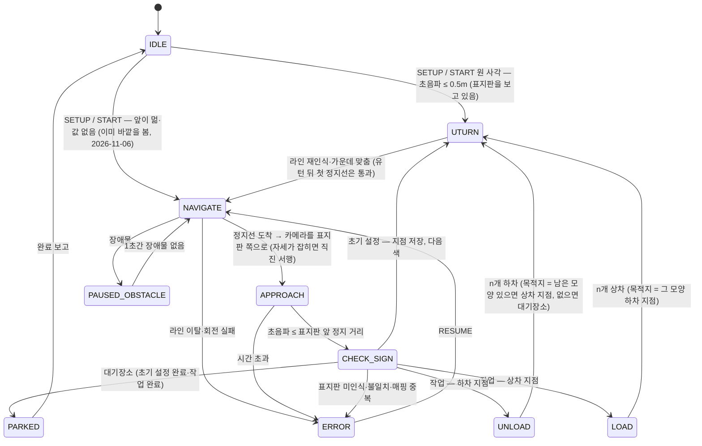

# 기능 설계서 — 차량 소프트웨어 (ROS 2)

> 대상 하드웨어: PiCar-R5 키트(Raspberry Pi 5, DRV8835 × 2, PCA9685, TT 모터 4개, 팬틸트) + Camera Module 3 Wide + 브레드보드(초음파, LED 2개, 7세그먼트 1자리)
> 소프트웨어: Ubuntu 24.04 LTS · ROS 2 Jazzy · Python(rclpy) / 노트북 Python 앱
> 관련 문서: [핀맵](../hardware/pinmap.md) · [배선도](../hardware/wiring.md) · [테스트 트랙](../track/test_track.md) · [블루투스 규약](../communication/bluetooth_protocol.md) · [AI 클래스](../ai/tm_classes.md)

---

## 1. 기능 ↔ 하드웨어 대응

| # | 기능 | 하드웨어 | 담당 노드 | 검증 단계 |
|---|------|----------|-----------|:---:|
| F1 | 영상 획득 | Camera Module 3 Wide (IMX708, CSI) | `camera_ros` (기존 패키지) | S0 |
| F2 | 카메라 각도 전환 | SG90 × 2 ← PCA9685 (I2C) | `pantilt_node` | S0, S6 |
| F3 | 모터 구동 | TT 모터 4개 ← DRV8835 × 2 (GPIO 18~25) | `motor_node` | S0 |
| F4 | 라인 추종·이벤트 검출 | 카메라 | `line_node` + `drive_node` | S1~S3 |
| F5 | 직각 회전·유턴 | 모터 + 카메라 | `drive_node` | S2, S8 |
| F6 | 색 마커 판별 | 카메라 | `marker_node` | S4, S5 |
| F7 | 표지판 인식 (AI) | 카메라 | `classifier_node` | S6 |
| F8 | 거리 측정 (표지판 앞 정지·장애물) | HC-SR04 (GPIO 5·6) | `ultrasonic_node` | S0, S6, S9 |
| F9 | 실은 화물 모양 표시 | LED 빨강·초록 (GPIO 16·26) | `led_node` | S0, S7 |
| F10 | 블루투스 제어·상태 보고 | Pi 5 내장 BT | `bt_bridge_node` | S0, S10 |
| F11 | 블루투스 영상 전송 | Pi 5 내장 BT | `bt_bridge_node` | S0 |
| F12 | 물류 처리 (상태 머신: 초기 설정·작업) | — | `mission_node` | S10 |
| F13 | 실은 화물 개수 표시 | 7세그먼트 1자리 (GPIO 4·27·12·13·9·10·11) | `segment_node` | S0, S7 |

---

## 2. 시스템 구조

```
 ┌──────────────────────── Raspberry Pi 5 (ROS 2 Jazzy) ────────────────────────┐
 │                                                                              │
 │  camera_ros ──/camera/image_raw──┬──► line_node ──/line/state, /stop_line/state──► drive_node  │
 │                                  ├──► marker_node ─/marker/state─► (drive_node)        │
 │                                  ├──► classifier_node (서비스)      │  │      │
 │                                  └──► bt_bridge_node (영상)     /cmd_vel│      │
 │                                                                    ▼  │      │
 │  ultrasonic_node ──/ultrasonic/range──► mission_node ◄────────► motor_node   │
 │                                         │  ▲   │                             │
 │  pantilt_node ◄──/pantilt/pose──────────┘  │   ├──/led/state──► led_node     │
 │                                            │   └──/display/digit──► segment_node │
 │                                            │                                 │
 │  bt_bridge_node ◄──/mission/status─────────┘                                 │
 │       │  └──/mission/command, /safety/estop──►                               │
 └───────┼──────────────────────────────────────────────────────────────────────┘
         │ Bluetooth RFCOMM (채널 1: 제어 / 채널 2: 영상)
 ┌───────┴──────── 노트북 Python 앱 ────────┐
 │  초기 설정 · 화물 개수 입력 · 비상 정지 · 수동 제어 · 매핑·상태·영상 표시 │
 └──────────────────────────────────────────┘
```

- `mission_node`가 전체 흐름(상태 머신)을 결정하고, `drive_node`는 "라인 따라가기·회전" 같은 주행 동작만 수행
- 영상 처리: 주행 중 `line_node`(라인·정지선)·`marker_node`가 프레임마다, `classifier_node`는 서비스 호출 시에만 처리

---

## 3. ROS 2 패키지 구성 (`ros2_ws/src/`)

> 모듈·클래스·계층 구조는 [소프트웨어 구조 설계](software_architecture.md)

| 패키지 | 빌드 | 내용 |
|--------|------|------|
| `agv_interfaces` | ament_cmake | 사용자 정의 메시지·서비스 (`.msg`, `.srv`) — 인터페이스 패키지는 CMake 필수 |
| `agv_hw` | ament_python | `motor_node`, `pantilt_node`, `ultrasonic_node`, `led_node`, `segment_node` (lgpio, smbus2) |
| `agv_vision` | ament_python | `line_node`, `marker_node`, `classifier_node` (OpenCV, LiteRT) |
| `agv_control` | ament_python | `drive_node`, `mission_node` |
| `agv_bt` | ament_python | `bt_bridge_node` (Python socket RFCOMM) |
| `agv_protocol` | ament_python | 블루투스 메시지 만들기·해석 (순수 Python, 노트북 앱도 같은 코드 사용) |
| `agv_bringup` | ament_python | launch 파일, 파라미터(`params.yaml`), 모델 파일 |

---

## 4. 토픽 · 서비스 · 액션

### 토픽
| 이름 | 타입 | 발행 → 구독 | 주기 | 내용 |
|------|------|-------------|------|------|
| `/camera/image_raw` | sensor_msgs/Image | camera_ros → vision, bt | 15~30Hz | 카메라 영상 |
| `/line/state` | agv_interfaces/LineState | line_node → drive_node, marker_node, bt_bridge | 영상 주기 | 라인 오프셋, 이벤트 |
| `/stop_line/state` | agv_interfaces/StopLineState | line_node → drive_node, bt_bridge | 영상 주기 | 정지선 판정·확정·기울기 |
| `/marker/state` | agv_interfaces/MarkerState | marker_node → drive_node, bt_bridge | 영상 주기 | 보이는 색 스티커의 색·위치(left/center/right — center = 앞 라인 위)·화면 높이 |
| `/cmd_vel` | geometry_msgs/Twist | drive_node·mission(수동) → motor_node | 20Hz | 선속도 x, 각속도 z |
| `/ultrasonic/range` | sensor_msgs/Range | ultrasonic_node → mission_node | 15Hz | 거리(m), 필터 적용 |
| `/pantilt/pose` | std_msgs/String | mission_node → pantilt_node | 이벤트 | `LINE` / `JUNCTION` / `SIGN` |
| `/pantilt/ready` | std_msgs/String | pantilt_node → mission_node | 이벤트 | 자세 변경 후 안정화 완료 (자세 이름) |
| `/led/state` | std_msgs/String | mission_node → led_node | 이벤트 | `OFF` / `RED` / `GREEN` / `ERROR` |
| `/display/digit` | std_msgs/String | mission_node → segment_node | 이벤트 | 7세그먼트 한 글자: `0`~`9`, `-`(초기 설정 중), `E`(오류), 빈칸(끔) |
| `/mission/command` | agv_interfaces/Command | bt_bridge → mission_node | 이벤트 | SETUP, START 원 사각, STOP, RESUME, MANUAL, MOVE |
| `/mission/status` | agv_interfaces/Status | mission_node → bt_bridge | 2Hz + 변화 시 | 상태, 진행, 실은 화물·개수, 목적지, 트랙 매핑 |
| `/mission/report` | std_msgs/String | mission_node → bt_bridge | 이벤트 | 블루투스 `EVENT`·`ERROR` 한 줄 (브리지가 그대로 전송) |
| `/agv/log` | std_msgs/String | drive_node·line_node → bt_bridge | 동작이 바뀔 때 | `"MARKER …"`·`"STOP …"` 동작 로그 → 블루투스 `DEV LOG` (2026-11-09, Pi 정지선 진단 로그 대신) |
| `/safety/estop` | std_msgs/Bool | bt_bridge·mission → motor_node | 이벤트 | 비상 정지 래치 |
| `/dev/wheels` | std_msgs/Float32MultiArray | bt_bridge → motor_node | 0.3초 반복 | 개발자 탭: L1~L4 듀티 (-1~1), 워치독 적용 |
| `/drive/speed` | std_msgs/Float32 | bt_bridge → drive_node | 이벤트 | 개발자 탭 "주행 속도": 라인 주행 기본 선속도 (0.2~1.0), 주행 중에도 적용 |
| `/drive/tune` | std_msgs/String | bt_bridge → drive_node | 이벤트 | 개발자 탭 "회전 세기"(`TURN 0.6`)·"라인 기준"(`CENTER -0.1`)·"회전 전 전진"(`FORWARD 0.6`)·"제자리 회전"(`SPIN 0.6`)·"회전 중 라인 무시"(`BLIND 2.0`)·"접근 속도"(`APPROACH 0.35`), 주행 중에도 적용 |
| `/drive/target` | std_msgs/String | bt_bridge(시험)·mission_node(예정) → drive_node | 이벤트 | 목적지 색 `red`/`green`/`blue`/`yellow`, `NONE`이면 마커를 보지 않음 |
| `/line/tune` | std_msgs/String | bt_bridge → line_node | 이벤트 | 개발자 탭 "확인 프레임"(`CONFIRM 3`)·"라인 끝 프레임"(`LINE_END 10`), 실행 중 적용 |
| `/dev/pantilt_angle` | std_msgs/Float32MultiArray | bt_bridge → pantilt_node | 이벤트 | 개발자 탭: [팬, 틸트] 각도 |

### 서비스 / 액션
| 이름 | 종류 | 제공 | 요청 → 응답 |
|------|------|------|-------------|
| `/drive` | 액션 `agv_interfaces/Drive` | drive_node | 동작(`FOLLOW_TO_EVENT` + 통과할 정지선 수, `UTURN`, `APPROACH`, `STOP`) → 결과 이벤트·성공 여부, 피드백 단계(`PASS STOP_LINE` 등) |
| `/vision/classify` | 서비스 `agv_interfaces/Classify` | classifier_node | 모드(`SIGN`) → 라벨, 신뢰도 |

### 사용자 정의 메시지 (agv_interfaces)
```
# LineState.msg
float32 offset          # 라인 중심의 좌우 오차 (-1.0 ~ 1.0)
bool    line_found
string  event           # NONE / STOP_LINE / JUNCTION_T / JUNCTION_LEFT / JUNCTION_RIGHT
                        # CORNER_LEFT / CORNER_RIGHT / LINE_END
string  raw_event       # 이번 프레임 판정 (연속 프레임 확인 전) — 검출 값 조정용
float32 angle           # 라인 각도(도) — 90 = 똑바로, 90 미만 = 위쪽이 오른쪽으로 기움
bool    angle_valid

# StopLineState.msg
bool    detected        # 이번 프레임 판정 — drive_node는 처음 나오면 일단 정지
bool    confirmed       # 확인 프레임만큼 쌓여 확정
float32 angle           # 정지선 기울기(도), 0 = 수평, + = 오른쪽이 위

# MarkerState.msg — 세 배열은 같은 길이
string[]  colors         # red / yellow / green / blue
string[]  sides          # left / right (라인 기준)
float32[] y              # 화면 높이 — 클수록 차에 가까움

# Status.msg
string state            # 상태 머신 상태 이름
string mode             # NONE / SETUP / WORK
uint8  done             # 작업: 하차한 화물 수 / 초기 설정: 확인한 지점 수
uint8  total            # 작업: 입력한 화물 수(원 + 사각) / 초기 설정: 4
string cargo            # 실은 화물 NONE / CIRCLE / SQUARE
uint8  load             # 실은 개수 (7세그먼트와 같음)
string target           # 작업: WORK / DROP_A / DROP_B / PARK, 초기 설정: 탐색 중인 색
string[] map            # 트랙 매핑 "WORK=blue" 4개, 모르면 "WORK=-"
string message          # 오류·알림 문구

# Command.msg  (bt_bridge → mission_node)
string kind             # SETUP / START / STOP / RESUME / MANUAL_ON / MANUAL_OFF / MOVE
uint8  circle           # START일 때 적(원) 수량 (0~99)
uint8  square           # START일 때 녹(사각) 수량 (0~99)
float32 linear          # MOVE일 때 선속도 (-1.0 ~ 1.0)
float32 angular         # MOVE일 때 회전 (-1.0 ~ 1.0)

# Drive.action
string command          # FOLLOW_TO_EVENT / UTURN / APPROACH / STOP
uint8  skip_stop_lines  # FOLLOW_TO_EVENT: 멈추지 않고 지나갈 정지선 수 (유턴 뒤 1)
---
bool   success
string result           # 끝난 이유: STOP_LINE / JUNCTION_* / CORNER_* / TURN_DONE / UTURN_DONE / STOPPED / E_TURN / E_LINE
---
float32 offset          # 진행 중 피드백: 현재 라인 오프셋

# Classify.srv
string mode             # SIGN (화물 모양은 입력값을 쓰므로 인식하지 않음, 2026-11-02)
---
string label            # 확정 라벨, 미확정이면 빈 문자열
float32 score
```

---

## 5. 상태 머신 (`mission_node`)

두 가지 모드로 같은 상태를 쓴다 (2026-11-02 사양 변경).
- **초기 설정(SETUP)**: 빨강 → 파랑 → 초록 순서로 목적지 색을 정해 따라가 표지판을 읽고, 색 ↔ 지점 대응(트랙 매핑)을 저장한다. 세 곳을 읽으면 남은 한 곳은 소거법 (2026-11-06)
- **작업(WORK)**: 입력한 모양별 개수만큼 상차 → 하차를 모양 하나씩 반복하고 대기장소로 돌아온다



- **공통 상태 (모든 상태에서 진입)**: `ESTOP`(BT 비상 정지·연결 끊김 → 모터 정지, RESUME 시 이전 상태로), `MANUAL`(BT 수동 제어, 해제 시 IDLE)
- `NAVIGATE`는 목적지 색을 `/drive/target`에 정하고 정지선까지 라인 추종 — 분기점 판단(색 스티커 좌우)과 회전은 `drive_node`가 한다 (6절, F6)

### 상태별 동작
| 상태 | 진입 시 동작 | 종료 조건 | 다음 |
|------|-------------|-----------|------|
| IDLE | 모터 정지, LED OFF, 7세그먼트 0, 팬틸트 LINE | `SETUP` 또는 `START 원 사각` 수신 | 초음파 ≤ `start_sign_distance`(0.5m)면 UTURN, 아니면 바로 NAVIGATE (어느 쪽이든 대기장소 정지선 통과, `EVENT DEPART UTURN|STRAIGHT 앞 …m`) |
| NAVIGATE | 팬틸트 LINE, `/drive/target` = 목적지 색, `/drive FOLLOW_TO_EVENT` | 이벤트 수신 | 아래 6절 |
| APPROACH | 정지선에서 **팬틸트 SIGN**(카메라를 표지판 쪽으로) → 자세 안정 후 `/drive APPROACH`(**직진** 서행, 라인·이벤트 무시 — 카메라가 위를 봄, 방금 멈춘 정지선 위를 지나감). 순서는 교수 변경 시나리오(2026-11-03) "정지선 → 카메라 → 전진 → 약 18cm 정지" (2026-11-06 변경). 정지 거리는 2026-11-06 사용자 결정으로 **30cm** | 초음파 ≤ 표지판 앞 정지 거리 / 시간 초과 | CHECK_SIGN / ERROR(`E_APPROACH`) |
| CHECK_SIGN | 정지, 팬틸트 SIGN, 자세 안정 후 `/vision/classify SIGN` | 표지판 확정 | 모드별 (아래) / 미인식 → ERROR(`E_SIGN`) |
| LOAD | 정지, 1초에 1개씩 `load` += 1 → 7세그먼트 표시, 첫 1개에 LED(물품 색) 켬 | `load` = 이번 적재량(최대 9) | 팬틸트 LINE → UTURN, 목적지 = 그 모양 하차 지점 |
| UNLOAD | 정지, 1초에 1개씩 `load` −= 1, `done` += 1 → 7세그먼트 표시 | `load` = 0 → LED 끔 | 팬틸트 LINE → UTURN, 목적지 = 남은 모양 있으면 WORK, 없으면 PARK |
| UTURN | 팬틸트 LINE, `/drive UTURN`, `skip_stop_lines = 1` | 라인 재인식 | NAVIGATE |
| PARKED | 정지(유턴 없음 — 다음 출발 자세), 완료 보고(BT) | 보고 완료 | IDLE |
| PAUSED_OBSTACLE | 정지, 상태 보고 | 1초 연속 장애물 없음 | 이전 동작 재개 |
| ERROR | 정지, LED ERROR(깜빡임), 7세그먼트 `E`, BT로 오류 코드 전송 | RESUME | 이전 상태 재시도 |

### CHECK_SIGN 이후 — 모드별
| 모드 | 읽은 표지판 | 동작 |
|---|---|---|
| 초기 설정 | 처음 보는 지점 | `map[지점] = 탐색 중인 색` 저장·보고(`MAPPED 지점 색`) → 세 곳째면 남은 지점 = 남은 색으로 저장(`MAPPED 지점 색 소거`), 남은 색이 있으면 다음 색으로 UTURN, 없으면 아래 |
| 초기 설정 | 이미 다른 색으로 저장된 지점 | ERROR(`E_MAP` — 색 스티커 누락·잘못 붙임) |
| 초기 설정 | 4곳 매핑 끝 (3곳 읽음 + 소거법) | 지금 지점이 대기장소면 PARKED(완료), 아니면 대기장소 색으로 UTURN → 도착해 표지판이 대기장소인지 확인 후 PARKED (아니면 `E_MAP`) |
| 작업 | 기대 목적지와 같음 | 상차 지점 → LOAD / 하차 지점 → UNLOAD / 대기장소 → PARKED |
| 작업 | 기대 목적지와 다름 | ERROR(`E_SIGN`) |

- **초기 설정 규칙 (2026-11-06 변경)**: 출발 표지판은 읽지 않고 바로 유턴해 라인을 따라간다. 탐색 순서는 **빨강 → 파랑 → 초록 → 노랑** 고정. 세 곳을 읽으면 남은 한 지점에 남은 한 색을 소거법으로 저장하고 그 지점은 가지 않는다 (대기장소가 남았으면 복귀하면서 표지판으로 확인됨). 이전: 출발 전에 대기장소 표지판을 읽고 4색을 모두 방문
- **매핑 저장**: Pi의 파일(`~/.agv/track_map.json`)에 저장해 다시 켜도 유지. 트랙을 바꾸면 초기 설정을 다시 한다. `START`는 4지점 매핑이 모두 있어야 받는다
- **작업 순서 (변경 시나리오 2026-11-03)**: 먼저 운반할 물품은 무작위, 한 물품을 다 옮긴 뒤 다음 물품. 1회 최대 9개라 넘으면 9개씩 여러 번 `WORK → DROP` 왕복, 마지막 하차 뒤 PARK(Start). 예: 적 12·녹 5, 녹 먼저 → 녹 5 / 적 9 / 적 3

## 6. 주행 · 분기점 판단

### NAVIGATE 처리 흐름
```
FOLLOW_TO_EVENT ─► 이벤트?
   ├ CORNER_LEFT / CORNER_RIGHT ─► 정지 → 같은 방향 90° 회전 → FOLLOW 재개
   ├ 목적지 색 스티커 ─► 앞 라인 위(center)면 그대로 직진 / 갈래 위면 감속 → 정지·확정 → 왼쪽 갈래 좌회전 / 오른쪽 갈래 우회전 → FOLLOW 재개 (drive_node, 2026-11-06 라인 위 마커)
   │     한쪽 스티커라도 그쪽에 라인 갈래(line_node branch_left/right)가 안 보이면 직진 (2026-11-06 실차: 직진·좌회전
   │     갈래뿐인 곳에서 스티커가 오른쪽 → 오른쪽으로 돌다 왔던 라인을 잡아 유턴처럼 됨)
   ├ STOP_LINE ─► skip_stop_lines > 0 이면 1 줄이고 통과 / 아니면 정지 → 카메라 SIGN → APPROACH(직진) → CHECK_SIGN
   └ LINE_END (정지선 없이 끝) / 라인 이탈 ─► ERROR
```

### 이벤트 중복 검출 방지
| 상황 | 문제 | 규칙 |
|------|------|------|
| 지점에서 유턴 후 되돌아감 | 표지판과 분기점 사이의 **그 지점 정지선**을 다시 지나며 APPROACH에 잘못 들어감 | 모든 UTURN에서 `skip_stop_lines = 1` → 다음 정지선 1개 통과 (지점마다 정지선이 하나라 항상 맞음). 출발 후 `pass_window_s`(3초) 안에 그 정지선이 한 번도 안 보이면(이미 카메라 아래 사각지대) 지난 것으로 보고 통과 횟수 0 — 목적지 정지선을 대신 지우지 않게 (2026-11-09) |
| 정지선 → 표지판 접근 | 멈춘 정지선 위를 바로 지나감 | APPROACH 중에는 라인 이벤트 무시 (카메라도 위를 봄) |
| 분기점에서 직진·회전 직후 | 같은 분기점의 가로 라인을 다시 이벤트로 검출 | `drive_node`는 STRAIGHT·TURN 완료 후 라인 이벤트가 사라질 때까지(최소 0.5초) 새 이벤트 무시 |

### 분기점 판단 (색 마커 규칙 — 2026-11-06 변경: 스티커를 **라인 테이프 위**에)
스티커는 분기점에서 나가는 **각 갈래 라인 위**에 그 갈래로 갈 수 있는 목적지 색을 붙인다 (이전 2026-11-02: 들어오는 라인 옆 좌우).
목적지 색 스티커가 **어느 라인 위**에 있는지가 방향을 정한다.

| 목적지 색이 보이는 곳 | 동작 |
|---|---|
| 앞으로 이어지는 라인 위 (center — 분기점 너머 직진 라인, 들어오는 라인) | 직진 (멈추지 않음) |
| 왼쪽 갈래 라인 위 | 좌회전 (그쪽에 갈래 라인이 안 보이면 직진) |
| 오른쪽 갈래 라인 위 | 우회전 (그쪽에 갈래 라인이 안 보이면 직진) |
| 양쪽 갈래 | 직진 (잘못 붙인 경우) |
| 안 보임 | 라인을 따라 계속 주행 |
- 판별: 스티커 바로 아래(차 쪽)로 검은 라인이 이어지면 앞 라인 위(center), 아래가 바닥이면 옆 갈래 위 → 라인 기준 좌우 (F6)
- 라인 인식은 라인 위 색 스티커를 라인의 일부로 본다(`sticker_as_line`) — 빼면 라인에 구멍이 남

- 다른 색만 보여도 오류로 보지 않는다 — 분기점을 지난 직후에도 다른 방향용 스티커가 정상적으로 보이기 때문. **스티커가 모두 떨어지면 그 자리에서 알 수 없고** T자는 `LINE_END`로 멈추며, 직진 갈래가 있는 곳은 도착 후 표지판 확인으로 잡는다
- 직진 스티커 2장 중 1장만 떨어지면 회전으로 잘못 읽는다 → 라인을 못 찾으면 시간 제한으로 `E_LINE`. 제한 시간은 90°보다 조금 더 도는 시간으로 맞춘다 (길면 들어온 라인까지 돌아가 되돌아갈 수 있음)

## 7. 기능별 상세 설계

### F1 · 영상 획득 (`camera_ros`)
- 카메라: Raspberry Pi Camera Module 3 Wide (IMX708, 대각 약 120° 광각, 자동 초점)
- 출력 640×480 → 노드마다 필요한 크기로 축소 (라인 320×240, AI 224×224, BT 영상 320×240)
- **초점**: 주행 중 자동 초점이 흔들리면 라인 검출이 불안정 → 자세별 고정 초점(LINE·JUNCTION·SIGN 각각 렌즈 위치 값)으로 운용, S0·S6에서 값 결정
- **광각 왜곡**: 화면 가장자리가 휘어 보임 → 라인 추종은 화면 아래 중앙 관심 영역만 사용, 마커 위치 판단에 문제가 되면 왜곡 보정(카메라 보정 1회) 적용
- 광각 덕분에 분기점에서 좌·앞·우 갈래 마커를 한 화면에 담기 쉬움

### F2 · 팬틸트 (`pantilt_node`)
- PCA9685(I2C 0x40 기본) 채널 = 서보 헤더 번호(조립 시 확정), 50Hz
- 자세 3가지 (각도는 S0·S6에서 보정, `params.yaml`)
  | 자세 | 용도 | 틸트 |
  |---|---|---|
  | LINE | 주행 중 라인·정지선·색 마커 검출, 유턴 | 아래 |
  | JUNCTION | (사용 안 함 — 2026-11-02 마커를 LINE 자세로 봄, 개발자 탭 시험용으로만 남김) | 약간 아래 |
  | SIGN | 표지판 인식 | 정면 |
- 자세 변경 후 0.3초 안정화 대기
- **팬 정면 자동 맞춤 (2026-11-06)**: 앱 개발자 탭 "정면 자동 맞춤"(`DEV CAL AUTO` → `/pantilt/calibrate`). 차를 곧은 라인 위에 똑바로 놓으면 LINE 틸트에서 `/line/state` 각도를 보며 팬을 돌려 라인이 수직(90° ± 1°)인 팬을 찾는다 — 카메라가 옆으로 비켜 달려도 정면이면 수직이라 오프셋이 아닌 각도로 판단. 순서: 지금 팬에서 각도 5장 중앙값 → 3° 돌려 다시 → 팬 1°당 각도 변화로 90°가 될 팬 계산(한 번에 최대 10°) → 반복(최대 8번, 30초). 결과는 `~/.agv/pantilt_cal.json`에 저장, **모든 자세의 팬 = 정면값**(틸트는 params). "초기화"(`DEV CAL RESET`)로 지우면 params 각도. 진행·결과 `/pantilt/calibration` → `DEV CAL RUNNING|DONE|FAIL|RESET|CANCELLED`. line_node가 돌고 있어야 함
- **SIGN 자세 틸트 (2026-11-06)**: params 기본 180 → **165**(실차: 너무 높음). 앱 개발자 탭 틸트 슬라이더로 표지판이 화면 가운데 오는 각도를 찾고 "틸트 → SIGN 저장"(`DEV CAL SIGN <틸트>`)을 누르면 같은 `pantilt_cal.json`에 저장, 이후 SIGN 자세는 그 틸트(빌드 필요 없음). "초기화"로 같이 지움
- GPIO17: 제어 없이 서보 동작 확인(2026-10-26) → 필수 아님. 드라이버는 안전하게 시작 시 LOW 출력(OE라면 출력 활성, 아니면 영향 없음)

### F3 · 모터 (`motor_node`)
- 입력 `/cmd_vel`(x: 선속도, z: 각속도) → 좌우 속도 = x ∓ z·k → 같은 쪽 바퀴 2개는 같은 값
- lgpio 소프트웨어 PWM 1kHz, DIR 핀으로 방향, **듀티 상한 75%**(TT 모터 보호, 파라미터)
- 바퀴 위치·방향 보정표(`params.yaml`): L1~L4 → 좌전·좌후·우전·우후, 극성 반전 여부 (S0에서 확정)
- 안전: `/cmd_vel` 0.5초 이상 끊기면 정지(워치독), `/safety/estop` true면 래치 정지

### F4 · 라인 추종 (`line_node` + `drive_node`)
- 처리: 영상 320×240으로 축소 → 하단 1/3 관심 영역 → 검정 추출(HSV: 줄의 바닥 밝기(상위 10%) × 0.72 이하 + 채도 낮음, 색 마커 제외 — 2026-11-02 광택 테이프 반사로 고정 문턱이 라인을 잃어 변경) → 연결 성분
- 라인 고르기 (2026-10-30, 주변 어두운 물체 대책): 줄마다 **폭 ≤ max_line_px(45px)인 가는 구간만** 라인 후보 — 두꺼운 물체는 붙어 있든 떨어져 있든 제외. 덩어리 점수 = 가는 구간 면적 × 가운데 가중치(양끝 0.3) × 직전 위치 가중치 × 화면 맨 아래에 닿으면 1.5배. 이벤트 판정은 **고른 라인과 이어진 영역만** 사용 — 가중치를 이벤트에 쓰면 화면 끝까지 뻗는 코너 라인을 놓치므로
- 오프셋: 고른 라인의 가까운 띠(관심 영역 아래 1/3)에서 아래 줄부터 위로, 줄마다 바로 아래 줄 위치에 가까운 가는 구간 중심의 평균 → -1.0 ~ 1.0. 라인을 못 찾으면 마지막 값 유지 + LINE_END
- 이벤트 검출 (위쪽 행 기준)
  | 이벤트 | 판단 |
  |---|---|
  | STOP_LINE | **`StopLineDetector`가 따로 판정** (같은 `line_node`) — `/stop_line/state`(아래 "정지선") |
  | ~~JUNCTION_T / LEFT / RIGHT~~ | **판정 안 함 — 분기점은 색 마커 인식이 맡음 (2026-10-30 결정)**. T자·옆 갈래 모양은 NONE, 마커를 놓쳐 T자에서 라인이 끊기면 LINE_END로 정지 |
  | CORNER_LEFT / RIGHT | 앞쪽 라인 없음 + 한쪽으로만 가로 라인 (폭이 라인 폭의 2배 이상 — 곧은 라인이 화면 끝에 있는 경우 제외) |
  | LINE_END | 관심 영역에 라인 없음 — 가까운 띠에서만 놓치고 직전 위치 근처 위쪽(중간·먼 띠)에 라인이 보이면 "잠깐 놓침"(NONE, 감속, 라인 끝 프레임의 2배까지), **10프레임 연속**이어야 확정 (2026-10-30: 3프레임이면 흔들림으로 잠깐 놓쳐도 멈춤) |
- **정지선 (`StopLineDetector`, 2026-11-02 세로 열 방식, 노드는 CPU를 줄이려고 `line_node`에 합침):** 가로 줄 방식은 기운 정지선을 놓침(실제 사진 +5° 대부분, ±15° 전부). 같은 검정 추출을 쓰고, 라인과 이어진 덩어리에서 **열마다** 가장 긴 세로 구간을 본다
  - 관심 영역은 라인(하단 1/3)보다 넓은 **하단 1/2** — 일찍 잡아야 지연·관성으로 지나쳐도 영역 안에서 멈춤
  - 관심 영역 위·아래에 닿는 열 묶음 = 라인 (정지선이 가까운 띠에 들어오면 라인 오프셋이 끌려가므로 위치는 이것으로 판단, 오프셋은 덩어리 고르는 데만 사용)
  - 정지선 열 = 위·아래에 닿지 않고 두께 ≥ 라인 폭 × 0.65 (위에 닿으면 아직 들어오는 중, 아래에 닿으면 곡선의 대각선 라인일 수 있음). 단 판정 후 20프레임 동안은 아래로 나가는 구간(두께 ≤ 라인 폭 × 2.5)도 인정 — 지나쳐 멈춘 뒤 판정이 사라져 재출발하는 것 방지. 3열까지 끊겨도 이어진 것으로 봄(테이프 반사)
  - 판정 = 정지선 열이 라인 왼쪽·오른쪽 모두 라인 폭 × 0.5 이상, 전체 폭 라인 폭의 3~12배, 화면 양끝 동시 도달 아님(T자 → 마커 인식), 기울기 ≤ 35°
  - **2026-11-09 교수 점검 반영:** ① 라인 폭은 차량에 가까운 끝에서 라인을 따라가다 정지선 줄에 닿은 바로 앞 8줄의 중앙값(정지선 높이의 폭) — 관심 영역 전체 중앙값은 원근 때문에 커서 먼 정지선이 기준을 겨우 넘고 첫 판정 직후 사라져 재출발했음. ② 판정 직후 20프레임은 두께 기준 0.5(시작 0.65). ③ 검정 + 라인 위 색 스티커 마스크(`line_mask`). ④ 판정이 참이면 분기점 확인 — 가로선이 양끝 너머로 라인 폭 × 3만큼 이어지거나 가로선 위에 스티커 색이 있으면 제외(비스듬히 다가간 스티커 T자에서 스티커 사이 구간을 정지선으로 보던 것). 트랙 전제: 정지선 가로선 위에는 스티커를 붙이지 않음
  - `drive_node`·`bt_bridge`가 `/line/state`에 합쳐 씀(0.3초보다 오래된 판정은 버림) — 앱 표시·주행 규칙은 그대로
- 라인 각도 (2026-10-30, 차량이 비스듬하면 라인이 대각선으로 보이는 문제): 관심 영역 맨 아래부터 위로 줄마다 라인 중심을 따라가 직선을 맞춰 각도 계산(90° = 똑바로, 90° 미만 = 위쪽이 오른쪽). 끝점 2개 대신 직선 맞춤 — 끝부분 흔들림에 덜 민감
- `drive_node` PID: 각속도 z = −turn_scale·(Kp·e + Kd·Δe + Kh·각도 오차/45°) (Ki는 필요 시), e = 오프셋 − center_offset(카메라가 차체 중심에서 비켜 달린 만큼, 2026-10-30 −0.10), 각도 오차는 85~95° 밖으로 벗어난 만큼만(`heading_deadband_deg` 5°). 선속도는 오차가 크면 감속. **정지선·코너는 판정 첫 프레임에 일단 정지하고 멈춘 채 확인 — 확정되면 끝(한 프레임 빠짐 허용), 판정이 5프레임 연속 사라지면 다시 출발** (2026-11-02: 달리면서 확인 프레임을 채우면 지나침). **LINE_END는 정지 후 3번(0.5초씩) 다시 봐서 라인이 3프레임 연속 보이면 자동 재출발, 끝까지 없으면 종료** (2026-11-02: 주행 중 잠깐 놓친 경우)
- 같은 이벤트가 연속 3프레임 이상일 때만 확정 (노이즈 방지)

### F5 · 직각 회전·유턴 (`drive_node`)
- TURN_LEFT/RIGHT: 정지선/분기점 위치에서 차체 반 길이 전진 → 제자리 회전(좌우 반대 방향) → 회전 중 라인이 화면 중앙에 들어오면 정지 → FOLLOW
- UTURN (2026-11-02 구현): 전진 없이 제자리 회전 (방향 `uturn_dir`: 2026-11-09부터 기본 −1 = 시계 방향 — 하드웨어가 좌회전에 약해 시험 중, 1 = 이전 반시계) → 기존 라인이 벗어난 뒤 라인이 기준 위치 ± 0.4, 각도 90 ± 35°로 3프레임 연속 보이면 정지·`UTURN_DONE`. 각도는 재지 않고, 시작 후 1.5초(`uturn_min_s`)는 라인으로 인정하지 않음. 8초 안에 못 찾으면 `E_TURN`. 회전 세기는 앱 "제자리 회전"과 같은 값. 시험은 개발자 탭 "U턴" 버튼 (`DEV DRIVE UTURN`)
- **유턴 후 맞추기 (2026-11-06):** 라인을 찾은 뒤 바로 끝내지 않고, 라인 오프셋을 기준 위치(앱 "라인 기준")로 천천히(회전 세기 0.3~0.45, 오차 비례) 돌려 맞춤. ± 0.1 안에서 멈춘 채 2프레임 연속이면 `UTURN_DONE`. 지나치면 되돌아 돌고, 라인이 안 보이면 마지막으로 본 쪽으로. 3초 안에 못 맞춰도 `UTURN_DONE` (빠르게 돌다 멈추면 관성·영상 지연으로 라인이 화면 끝에 남아 다음 출발에서 놓쳤음)
- 안전 시간 제한: 마커 회전 4초 / 유턴 8초 (실제 회전 속도를 보고 줄임)
- 회전 속도·전진 거리는 S2·S8에서 보정

### F6 · 색 마커 판별 (`marker_node`)
- 마커 = 지름 약 2cm 원형 스티커. 카메라 자세는 LINE 그대로 (JUNCTION 자세로 바꾸지 않음)
- 처리 (`agv_vision/marker.py`): 320×240 → HSV → 색별 범위 → 열림(3×3) → 연결 성분 → 스티커 조건 (면적 ≥ 30, 면적 ÷ 외접 사각형 ≥ 0.5, 가로 폭 = 높이별 예상 지름의 0.5~1.6배, 세로 ≤ 2배)
- **위치 판별 (2026-11-06 라인 위 마커)**: 스티커 중심에서 지름 × 0.8~1.8 아래, 좌우 ± 지름 × 0.3 창이 50% 이상 검정이면 **center**(앞으로 이어지는 라인 위). 창이 화면 밖(바로 앞)이면 라인 위치에서 지름 안이면 center. 아니면 옆 갈래 위 → 좌우
- 좌우는 **라인 기준** (카메라가 차체 중심에서 비켜 있음). 라인이 기울면 라인 각도로 스티커 높이의 라인 위치를 계산해 비교
- 사용자 사진(2026-11-06 T자: 들어오는 라인 노랑, 직진 라인 파랑, 왼쪽 갈래 빨강·초록)에서 노랑·파랑 center, 빨강 left 확인 (라인 위치를 맞게 줬을 때). 초록은 사진에서 반사로 S 약 40이라 안 잡힘 → 카메라 영상으로 확인 필요
- HSV 범위 (2026-11-02 책상 위 실제 스티커 사진, 트랙에서 다시 확인): 빨강 H168~10·S≥125·V≥125, 노랑 H24~38·S≥120·V≥120, 초록 H60~85·S≥90·V≥70 (가장 약함), 파랑 H100~116·S≥120·V≥90 → `params.yaml`
- 출력 `/marker/state`: 색, 좌우, 화면 높이 — 높이는 거리 대신 쓰고, 앱 "MARKER" 측정값으로 확인
- 판단은 `drive_node` (`DriveController`, 목적지 색이 정해졌을 때만):
  1. 주행 중 목적지 색이 y ≥ 60에 보이면 감속, y ≥ 120까지 오면 정지 — 높이로 정해서 속도와 상관없이 비슷한 자리에 섬
  2. 0.3초 뒤부터 5프레임을 보고 과반으로 좌우 확정 (y ≥ 90만 — 건너편 스티커 제외). 사라지면 오판정으로 보고 다시 출발
  3. 회전: **전진** (회전 중심을 분기점 가까이, 카메라가 차축보다 앞을 보기 때문) → **제자리 회전** → 기존 라인이 벗어난 뒤 새 라인이 보이면 끝 → 라인 주행. 회전 각도는 재지 않는다 (엔코더 없음)
     - 기존 라인이 벗어남: 라인이 인정 범위 밖으로 2프레임, 또는 오프셋이 도는 쪽으로 0.25 이상 튐 (광각이라 기존 라인이 나가기 전에 새 라인이 들어옴)
     - 새 라인 인정: 기준 위치 ± 0.4, 각도 90 ± 35° (T자 가로선 제외), 3프레임 연속
     - 4초 안에 못 찾으면 정지·`E_LINE`
  4. 회전 뒤 1초는 정지선·코너·라인 끝 무시, 직진·회전 뒤 2초는 마커 무시 (같은 표시 재인식 방지)
- 전진 시간은 스티커 위치와 실제 속도에 맞춰 앱 "회전 전 전진"으로 조정

### F7 · 표지판 인식 (`classifier_node`)
- Teachable Machine 이미지 모델 → TFLite 변환 → LiteRT(`ai-edge-litert`)로 추론, 입력 224×224
- 모델 1개: `sign.tflite`(`sign_work` / `sign_drop_a` / `sign_drop_b` / `sign_park` / `background`). 화물 모양은 앱 입력값을 쓰므로 인식하지 않음 (2026-11-02)
- 5프레임 연속 추론 → 신뢰도 **0.7** 이상이 3회 이상 같은 라벨이면 확정 (2026-11-06 0.8 → 0.7: 실차 0.73~0.87로 확정 못 함), 아니면 1회 재시도 후 실패(`E_SIGN`, 초기 설정 중이면 `E_MAP`) — 클래스 상세는 [tm_classes.md](../ai/tm_classes.md)
- 카메라 영상은 분류 요청(`/vision/classify`) 중에만 구독 (2026-11-06) — 늘 받으면 주행 중 Pi 부하로 line_node 처리 프레임이 줄어 정지선을 지나쳤음

### F8 · 초음파 (`ultrasonic_node`, 해석은 `mission_node`·`drive_node`)
- 15Hz 측정(Trig 10µs 펄스 → Echo 펄스 폭), 이동 중앙값 필터 5개, 범위 밖(2cm 미만·200cm 초과)은 무시
- 해석은 상태에 따라 다름
  | 상태 | 해석 | 기준 (파라미터, S7·S9에서 보정) |
  |---|---|---|
  | APPROACH | 표지판 앞 정지 거리 | 거리 ≤ **30cm** 3회 연속 → 정지 (2026-11-06 사용자 결정, 변경 시나리오는 "약 18cm") → 카메라 자세가 잡힌 뒤 **1초 기다렸다** 분류(`sign_settle_s`). 10초 안에 도달 못 하면 `E_APPROACH` |
  | 라인 주행 (drive `FOLLOW_TO_EVENT`) | 정지 (2026-11-06) | **drive_node**가 거리 ≤ 18cm 3회 연속(값 없음은 건너뜀)이면 정지·결과 `OBSTACLE` (`obstacle_stop`). 마커 회전의 제자리 회전 중은 제외(회전 전 전진은 봄). 개발자 탭 ▶ 출발에서도 동작. mission NAVIGATE에서는 PAUSED_OBSTACLE → 18cm보다 먼 상태 1초면 재개 |
  | UTURN | 무시 | 표지판을 보고 선 자리에서 시작하므로 보지 않음 |
  | (mission 장애물) | 기본 꺼짐 | `obstacle_enabled: true`면 NAVIGATE·UTURN에서 한 번이라도 ≤ 18cm → PAUSED_OBSTACLE (이전 방식) |
  | 기타 | 무시 | — |
- **배치 제약**: 정지선에 멈췄을 때 차량 앞~표지판 거리가 정지 거리(18cm)보다 짧으면, 정지선에 닿기 전에 표지판을 장애물로 보고 멈춘다 (2026-11-06부터 라인 주행 중 초음파 정지가 켜져 있음 — 표지판은 치워지지 않으므로 재개도 안 됨) → **표지판은 정지선에서 정지 거리 + 10cm 이상(약 28cm), 유턴할 때 정지선이 보이지 않을 만큼 떨어뜨린다**. 표지판 판은 초음파가 반사될 만큼 평평하고 크게(약 10cm 이상)

### F9 · LED (`led_node`)
| 명령 | 빨강 GPIO16 | 초록 GPIO26 |
|---|---|---|
| OFF (빈 차) | 끔 | 끔 |
| RED (원 실음) | 켬 | 끔 |
| GREEN (사각형 실음) | 끔 | 켬 |
| ERROR | 0.5초 간격 둘 다 깜빡임 | 〃 |

### F13 · 7세그먼트 (`segment_node`)
- 1자리 7세그먼트를 GPIO 7개로 직접 구동 (a~g, 소수점 미사용) — 핀은 [pinmap.md](../hardware/pinmap.md), 세그먼트마다 330Ω
- `/display/digit`(String 한 글자) → `0`~`9` 숫자, `-`(초기 설정 중), `E`(오류), 빈칸(끔)
- 표시 = 실은 화물 개수: 상차 중 1초마다 1 증가, 하차 중 1초마다 1 감소 (`mission_node`가 보냄)
- 공통 캐소드/애노드는 부품에 맞춰 파라미터 `common_anode`로 반전

### F10·F11 · 블루투스 (`bt_bridge_node`)
- RFCOMM 서버, **채널 1 제어 / 채널 2 영상** 분리 → 영상이 밀려도 제어 명령은 지연되지 않음
- 하트비트: 노트북이 0.5초마다 PING, 1.5초 동안 아무 수신이 없으면 연결 끊김 → `/safety/estop` true
  - 부팅 후 **첫 연결 전에는 감시하지 않음** (차량은 IDLE로 정지 상태라 안전, START는 연결 후에만 가능)
- 비상 정지 해제: `/safety/estop` true는 `motor_node`에 래치되고, RESUME 시 `mission_node`가 false를 발행해야만 풀린다
- 영상: `/camera/image_raw` → 320×240 JPEG(품질 50) → 초당 5프레임, 보낼 차례에 최신 프레임만 전송(밀린 프레임 버림)
- 메시지 형식은 [bluetooth_protocol.md](../communication/bluetooth_protocol.md)

---

## 8. 예외 처리 대응

| 상황 | 감지 | 대응 | 복귀 |
|------|------|------|------|
| 장애물 | 라인 주행 중 초음파 ≤ 18cm 3회 연속 (drive_node `OBSTACLE`) | PAUSED_OBSTACLE (정지) | 1초간 18cm보다 멂(2m 안에 아무것도 없어 값 없음도 포함, 2026-11-06) → 자동 재개 |
| 블루투스 끊김 | 1.5초 무수신 | ESTOP (모터 정지) | 재연결 + RESUME |
| 비상 정지 | BT `STOP` | ESTOP | RESUME |
| 표지판 미인식·불일치 | 확정 실패 또는 기대 목적지와 다름 | ERROR(`E_SIGN`) + BT 알림 | 수동으로 차량 이동 후 RESUME |
| 매핑 실패 (초기 설정) | 표지판 미인식, 같은 지점이 두 색에서 나옴 | ERROR(`E_MAP`) + BT 알림 | 스티커 확인 후 초기 설정 다시 |
| 표지판 앞 도달 실패 | APPROACH 10초 초과 | ERROR(`E_APPROACH`) | RESUME |
| 매핑 없이 작업 시작 | `START` 수신 시 매핑 4개 미만 | `NAK START 초기 설정 필요` | 초기 설정 |
| 라인 이탈 (옵션) | LINE_END/라인 없음 1초 | 정지 → 좌우로 천천히 탐색(2초) → 실패 시 ERROR | RESUME |
| 회전 실패 | 회전 시간 제한 초과 | ERROR | RESUME |

---

## 9. 운용 규칙
| 항목 | 규칙 |
|------|------|
| 출발 위치 | 대기장소 (2026-11-06: **방향은 상관없음**) — 출발할 때 초음파로 판단: 앞 0.5m 안에 표지판이 있으면 유턴부터, 아니면 바로 라인을 따라감. 초기 설정·작업이 끝난 자세는 표지판을 바라보는 방향 |
| 부팅 자동 실행 | Pi 부팅 시 `agv.launch.py`를 systemd 서비스로 자동 실행 (시연 때 모니터·키보드 없이 사용) — 3단계에서 설정 |
| 배터리 | 작업 전 키트 전압계로 7.4V 배터리 전압 확인, 기준(예: 7.0V) 미만이면 충전 후 운용 — 기준값은 S0에서 결정 |
| 트랙 변경 | 지점·색 스티커 배치를 바꾸면 초기 설정을 다시 실행 |
| 종료 | 노트북 앱 연결 해제 → 전원 스위치 OFF (Pi는 `shutdown` 후 끄는 것이 안전) |

## 10. 파라미터 (`agv_bringup/config/params.yaml` 예정)
| 그룹 | 항목 | 초기값 | 보정 단계 |
|------|------|--------|:---:|
| motor | 듀티 상한, 바퀴 위치·극성, PWM 주파수 | 75%, —, 1kHz | S0 |
| drive | 주행 속도, PID 게인, 회전 속도, 회전 전 전진 거리 | — | S1, S2, S8 |
| line | 이진화 방식, 관심 영역, 정지선 폭 비율 | Otsu, 하단 1/3, 2~5배 | S1, S3 |
| marker | 4색 HSV 범위, 최소 면적, 다수결 프레임, 갈래 영역 경계(back 제외 영역 포함) | — , —, 10, — | S4, S5 |
| layout | 정지선~표지판 거리, 표지판 앞 정지 거리, 유턴 공간 | 25cm 이상, 18cm, — | S6, S8 |
| pantilt | LINE·JUNCTION·SIGN 각도, 서보 채널 | — | S0, S5, S6 |
| ultrasonic | 표지판 앞 정지 거리·접근 시간 제한, (장애물 거리·해제 시간 — 기본 꺼짐) | 30cm·10초, 18cm·1초 | S6 |
| classifier | 모델 경로, 신뢰도 기준, 재시도 | —, 0.8, 1 | S6 |
| mission | 상차·하차 간격, 매핑 파일 | 1초, `~/.agv/track_map.json` | S7, S10 |
| segment | 세그먼트 핀, 공통 단자 종류 | GPIO 4·27·12·13·9·10·11, — | S0 |
| bt | 하트비트 시간, 영상 해상도·fps·품질 | 1.5초, 320×240·5·50 | S0 |
